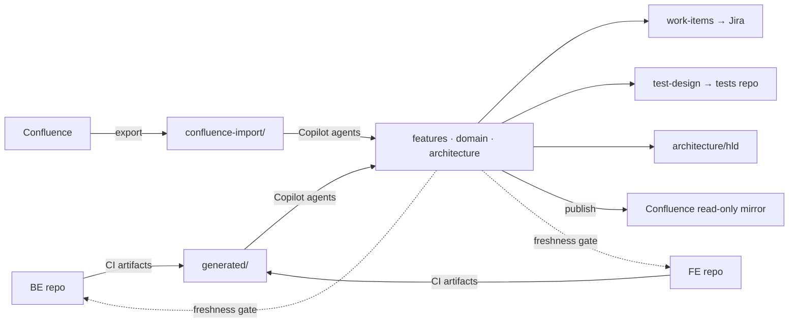

# Investigation: Docs-as-Code repository for the Financial Advisory Platform

**Date**: 2026-09-30 · **Status**: proposal · **Prototype**: `docs-repo/`

## 1. Problem

| Fact | Consequence |
|---|---|
| 2-year-old bank platform (React FE, Kotlin/Spring/Maven BE, PostgreSQL, Kafka, external services) | Large, heterogeneous codebase; reading it with an LLM is expensive |
| Heavy domain: hedges, loans, monthly computations, stress tests, graphs, admin | Business rules and formulas are the most valuable and most drift-prone knowledge |
| Docs in Confluence, drifting | No review, no CI, not machine-consumable |
| Downstream needs: analytics, Jira epics/stories/subtasks, test cases + data for an existing tests repo, HLD | Docs must be structured enough to be *inputs* for automation |
| Constraints: Copilot allowed; **no MCP, no external agent frameworks or skills in the code repos** | Everything must live in the docs repo as Copilot-native customisation (instructions / agents / prompts / skills) + plain scripts |

## 2. Options considered

| Option | Verdict | Why |
|---|---|---|
| A. Keep Confluence as source, generate from it | ✗ | No diff/review/CI; Copilot cannot use it as context; drift continues |
| B. Docs inside BE repo (`/docs`) | ✗ | FE docs split off; huge context for Copilot; access/ownership coupling; can't add agents/skills there |
| **C. Dedicated docs repo, docs-as-code (chosen)** | ✓ | Reviewable, CI-checkable, small focused context, Copilot customisation allowed, tool-agnostic (Markdown/Mermaid/YAML) |
| D. Wiki (GitHub/GitLab wiki) | ✗ | Weak PR flow, no CI, no folder conventions, no Copilot customisation |
| E. Full DocOps platform (Backstage TechDocs, Docusaurus site) | later | Nice rendering, but adds infra; can be layered on C later |

## 3. Recommended architecture (Option C)

### 3.1 Content model
- **`features/<ctx>/<ID>.md`** — functional spec with YAML frontmatter (id, context, status, `code_refs`, api,
  events, tables, calculations, jira, tests, `last_verified`). Numbered business rules `BR-<ID>-n` are the
  traceability atoms cited by stories and test scenarios.
- **`domain/calculations/*.md`** — formula + conventions (day-count, rounding, calendar, negative rates) +
  **worked examples** (taken from BE unit tests). This is the key asset for a computation-heavy app: once written,
  analysts, testers and agents never need to open Kotlin.
- **`domain/glossary.md`** — canonical terms; prevents synonym drift across Jira, tests and docs.
- **`architecture/`** — arc42-lite, C4 in Mermaid, ADRs, integration/Kafka map (partly generated).
- **`generated/`** — CI-produced, read-only: OpenAPI (springdoc), AsyncAPI (springwolf), DB schema + ERD
  (Liquibase→SchemaSpy/pg_dump→Markdown), Kotlin public API surface (Dokka, no bodies), TS `.d.ts` surface, route
  map, **codebase map** (module → responsibility → entry points → feature IDs).
- **`work-items/*.yml`** — epic/stories/subtasks with Gherkin acceptance criteria → Jira via REST or CSV.
- **`test-design/`** — Gherkin `.feature` + synthetic fixtures + shared **step vocabulary** (contract with tests repo).
- **`docs-map.yml`** — code path globs → specs; drives PR-to-spec mapping and the freshness gate.

### 3.2 Keeping docs and code in sync
1. FE/BE CI (on merge to main) regenerates artifacts and opens a PR in the docs repo labelled `generated`
   (`ci-examples/be-publish-generated.yml`, `fe-publish-generated.yml`).
2. The `doc-sync` agent (or a human) processes that PR: maps changed paths → specs, diffs against contracts,
   updates specs, bumps `last_verified`, flags tests to review.
3. FE/BE PRs run a **freshness gate** (`ci-examples/code-repo-freshness-gate.yml` → `scripts/check-freshness.ps1`):
   touching a mapped path requires a recent `last_verified` or the label `docs-not-affected`.
4. Confluence becomes a **read-only mirror** published on merge (banner: "managed in Git").

### 3.3 Copilot customisation (no MCP / frameworks)
All native Copilot files, in the docs repo only:

| Artefact | Files | Role |
|---|---|---|
| Repo instructions | `.github/copilot-instructions.md` | golden rules, source priority, token discipline, confidentiality |
| Scoped instructions | `.github/instructions/*.instructions.md` (`applyTo` globs) | rules load only when editing specs / work items / tests / generated |
| Agents | `.github/agents/{doc-sync,analyst,test-designer,architect,confluence-migrator}.agent.md` | one persona per downstream artefact, each with strict "what to read" lists |
| Prompts | `.github/prompts/*.prompt.md` | one-shot parametrised tasks (`/spec-from-code`, `/jira-from-spec`, …) |
| Skills | `.github/skills/<name>/SKILL.md` + `references/` | reusable procedures with progressive disclosure |

### 3.4 Token-saving strategy (the core design driver)
| Technique | Effect |
|---|---|
| **API surface instead of source** (Dokka/`.d.ts`, signatures only) | 10–50× fewer tokens than implementation for "what exists / what fields" questions |
| **Lib-free code maps in the code repos** (`code-repo-kit/`, §3.8: endpoints, topics, tables, routes, types, `@docs` tags with `file:line`) | same effect without build plugins; works where third-party libraries are not allowed |
| **Codebase map** (module → responsibility → entry file) | replaces directory walks and speculative file opens |
| **Calculations as formula + worked examples** | tests/analytics derived from ≈50 lines of Markdown instead of thousands of lines of Kotlin |
| **Source priority ladder** in every agent (docs → generated → narrow source ranges) | agents stop at the cheapest sufficient source |
| `applyTo`-scoped instructions, short SKILL.md + `references/` | only relevant rules enter context |
| FE/BE as read-only extra workspace folders (or sparse checkout of `src/main`) | avoids indexing tests/build output |
| Prefer BE unit tests over services when edge cases are needed | tests are dense in facts, cheap in tokens |
| Output discipline ("files only, ≤ N lines in chat") | prevents echoing large content back |
| Spec size cap (~300 lines) and diagram cap (≤ 25 nodes) | keeps any single read bounded |

### 3.5 Downstream automation
| Output | Agent | Transport (no MCP) |
|---|---|---|
| Jira epic/stories/subtasks | `analyst` → `work-items/*.yml` | `scripts/jira-push.ps1` (REST v3) or `jira-csv.ps1` (bulk import) |
| Test cases + data | `test-designer` → `test-design/` | `scripts/push-to-tests-repo.ps1` (git + PR API); tests repo CI reports unimplemented steps |
| HLD / ADR | `architect` → `architecture/hld`, `adr` | in-repo |
| Analytics / reports | frontmatter is machine-readable → `build-index.ps1`, coverage matrices (BR ↔ scenario ↔ story) | in-repo, CI-generated |
| Confluence | `confluence-publish.ps1` | Confluence REST (one-way) |

### 3.6 Quality gates (docs repo CI)
markdownlint · frontmatter/ID validation · OKF §11 conformance (`okf-validate.ps1 -Strict` + reference Python
checker) · `index.md` freshness (`build-index.ps1 -Check`) · link check (lychee) · Mermaid compile ·
Spectral/AsyncAPI lint of generated contracts · work-items schema · freshness (in code repos) · OKF graph artifact.

### 3.7 Knowledge format: Google Open Knowledge Format (OKF v0.2)

**Decision:** the docs repo *is* one OKF bundle (root `index.md` with `okf_version: "0.2"`); repo-specific
keys (`id`, `code_refs`, `jira`, `tests`, …) are kept as extensions. Why OKF rather than a home-grown convention:

| Need | OKF construct | Effect for us |
|---|---|---|
| Agents must find the right doc cheaply | reserved `index.md` per folder, one line + description per concept (§8) | progressive disclosure: root → area → concept; ~2–3k tokens to orient instead of listing/reading source |
| Trust: which docs can an analyst/test-designer rely on? | `generated.by`, `verified[].by` with actor shapes `human:<id>` / `copilot/<agent>` / `process:<ci>` (§5, §7) | index badges `unverified · machine-confirmed · human-reviewed · STALE`; agents downgrade or flag `@needs-review` |
| Formulas that must match code | `Attested Computation` (`runtime`, `parameters`, `# Computation`, `executor/attester`) (§10) | `domain/calculations/*.md` become executable-by-contract specs, verifiable in the tests repo |
| Provenance for migrated Confluence content | `sources[]` + `[^id]` footnotes (§5.1) | each claim traceable to page/author/date; replaces ad-hoc `confluence_sources` |
| Ageing | `stale_after` (§5.5), `status` enum (§5.4) | validator flags STALE; freshness becomes machine-checkable |
| Interop | Apache-2.0 spec, plain Markdown+YAML, deterministic checker | no lock-in; any tool/agent that understands OKF can consume the bundle |

**Toolkit:** the Claude Code `scaccogatto/okf-skills` (MIT) was ported to GitHub Copilot customisation:

| okf-skills (Claude) | Copilot port | Notes |
|---|---|---|
| `skills/okf` (produce/maintain/consume) | `.github/skills/okf/SKILL.md` + `PORTING.md`, vendored `SPEC.md`, templates, `okf_init.py` | rewritten repo-specific (bundle = repo root, our type vocabulary, actor names) |
| `skills/validate` | `.github/skills/okf-validate/` (Python) + `scripts/okf-validate.ps1` (PowerShell, no-Python workstations) | PS port adds trust/provenance warnings; templates checked §11-only |
| `skills/visualize` | `.github/skills/okf-visualize/` | CI uploads `okf-graph.html` artifact |
| agents + Stop hook | `.github/agents/*.agent.md` steps + CI gate | Copilot has no hooks → gate enforced in CI |
| MCP server, backfill subagents, `.claude-plugin`, `action.yml` | **not ported** | MCP not permitted; backfill low value; action inlined in workflow |
| — | `scripts/build-index.ps1` | new: deterministic index generation with trust badges |

Licences retained under `third-party/`. Bank note: vendored Python needs a security review and commit pinning.

### 3.8 Token efficiency inside the FE/BE repos (`code-repo-kit/`)

Constraint: no third-party libraries or skills in the code repos; custom scripts, Copilot customisation files and
IDE plugins (Copilot itself, an in-house VS Code extension) are allowed. Copilot spends tokens on *finding* and
*reading*; the kit attacks both.

| Lever | What ships | Effect |
|---|---|---|
| **Content exclusion** (GitHub repo/org setting; honoured by VS Code *and* IntelliJ plugins) | `shared/copilot-content-exclusion.yml`: `target/`, `build/`, `node_modules`, lockfiles, generated clients, snapshots, big fixtures, old migrations, env configs | noise never enters context or the index; also a secrets guard |
| **Generated maps, lib-free** (PowerShell regex, no build) | `scripts/docs/gen-*.ps1` -> `docs/_generated/`: `codebase-map`, `api-index`, `events`, `db-schema`, `routes`, `types-index`, `docs-tags` (+ `index.md`); `gen-all.ps1 -Check` freshness gate | agents read 1 row per module/endpoint/topic/table with `file:line` (~300 tokens) instead of walking directories or opening controllers |
| **Spec-to-code tags** `@docs <ID>` in KDoc/JSDoc | `docs-tags.md` + prompt `find-spec-code` | `HEDGE-001` -> exact declarations; no repo-wide search |
| **Read-order instructions** | `copilot-instructions.md` (<= 60 lines): maps -> facade -> one range; "never open" list; output discipline (diffs, <= 15 lines) | bounds every answer; applies in both IDEs |
| **Scoped rules** | `*.instructions.md` with `applyTo` for `calc/`, `messaging/`, tests, `src/features/` | rules load only when relevant |
| **Read-only agents** | `code-reader` (max 3 files, maps first), `impact-analyst` (blast-radius checklist) | cheap Q&A before any implementation agent |
| **Code shape** | facade per module, feature barrels + `*.types.ts`, file cap 400/300 lines via `check-file-size.ps1` (baseline for legacy) | `#file` pulls whole files - smaller files, cheaper reads |
| **IDE scope** | IntelliJ *Unload Modules* + scopes; VS Code per-context `*.code-workspace` (BE module + FE feature + `_generated` + docs); remote workspace index | the model sees one bounded context, not two repos |
| **MCP-free retrieval** | in-house VS Code extension: tools `#docsLookup`, `#codeMap`, `#specToCode`, `#impact` + `@docs` participant (`vscode.lm.registerTool`, no runtime deps) | agent mode gets a few hundred tokens with trust badge + `file:line` instead of `@workspace` dumps; JetBrains has no tool API -> instructions + prompts + `graph-query.ps1` only |
| **CI** | `ci/docs-maps.yml`: freshness + size gate on PR; on `main` pushes maps to docs repo `generated/<repo>/` as OKF `Document`s | maps stay true; docs repo consumes them unchanged |

Verified on `samples/be-mini` / `samples/fe-mini` (see §8). The springdoc/Dokka/AsyncAPI path in `ci-examples/`
remains the richer option *if* build plugins are later allowed; the regex generators cover ~80 % of agent
questions (where / which / who-calls) without them.

### 3.9 Architectural knowledge graph (graphify / codegraph / tree-sitter assessed; in-house hybrid chosen)

Question: should we build something like **graphify**, a **codegraph**-style MCP server or a **tree-sitter**-based
indexer so agents query a graph instead of reading code - and which fits our constraints (no third-party libraries in
the code repos, no MCP, JetBrains + VS Code, bank audit)?

| Tool family | How it works | Token-saving mechanism | Why not as-is |
|---|---|---|---|
| graphify (safishamsi) | tree-sitter AST + **LLM-extracted** semantic edges -> networkx -> Leiden communities -> `GRAPH_REPORT.md` | agent reads report/graph instead of files | Python + networkx + tree-sitter + LLM-built edges (non-deterministic, unauditable); Claude-Code hooks; language-generic - knows nothing of Spring/Kafka/Flyway; single repo |
| codegraph-style (code-graph-rag, codegraph MCP servers) | tree-sitter -> symbol graph (file/class/function/import/call) -> Neo4j/Memgraph/Kuzu -> MCP tools | query by tool, never read files | **requires MCP** + a graph DB; symbol-level graph of a 2-year Kotlin BE = tens of thousands of nodes, useless without the tool - which JetBrains cannot host |
| aider repo-map | tree-sitter tags -> PageRank over references -> top symbols emitted within a **token budget** | fixed-size map always in context | tree-sitter lib; but the *rank + budget* idea is library-free and the single best lever |
| raw tree-sitter (Kotlin/TSX) | syntax only, no type resolution | - | native/WASM library; call edges through interfaces and DI are exactly the ambiguous ones |

**Key insight.** Docs, Jira analytics and test design reason about *architectural* nodes - module -> endpoint -> facade
-> calculator -> table, topic -> consumer, FE feature/route -> endpoint, spec ID -> code -> tests. That graph has a few
hundred nodes, not 50 000, and we can extract it precisely with **zero new libraries**:

| Layer | Source of truth | Mechanism (all lib-free) | Shipped |
|---|---|---|---|
| Nodes + approximate edges | the regex maps already in `code-repo-kit` | `docs-repo/scripts/gen-graph.ps1` joins `generated/be/*` + `generated/fe/*` + `@docs` tags | `graph.json`, `graph/<community>.md`, `REPO_MAP.md` |
| Precise BE edges | the running Spring context (`spring-boot-starter-test` is already a dependency) | `GraphExportTest.kt`: `BeanFactory.getDependenciesForBean` (DI through interfaces), `RequestMappingHandlerMapping`, `KafkaListenerEndpointRegistry`, JPA `Metamodel` -> `graph-export-be.json` | template `be/templates/GraphExportTest.kt` (verify on the real repo) |
| Precise FE edges | TypeScript compiler API (`typescript` is already a devDependency) | `gen-graph-fe.ts`: component/hook nodes, `uses`/`renders` edges via the type checker, `fetch/axios` URLs resolved incl. `const BASE` + HTTP method -> `graph-export-fe.json` | `fe/scripts/docs/gen-graph-fe.ts` (verified on `fe-mini`) |
| Communities | Maven modules / FE feature folders (same name = one bounded context across repos) + connected components | deterministic, meaningful for the domain; no Leiden | in `gen-graph.ps1` |
| Ranking / budget | PageRank (30 lines) + `-Budget` lines | aider-style `REPO_MAP.md`, lower-ranked nodes only in `<community>.md` | in `gen-graph.ps1` |
| Query | BFS over `graph.json` | VS Code tool `#impact <node|file>` (+ `@docs /impact`); CLI `scripts/graph-query.ps1 -Node / -Files / -Find` for IntelliJ + CI | both shipped |
| Freshness | CI | `gen-graph.ps1 -Check` in docs-repo CI; code-repo CI publishes `graph-export-*.json` with the maps | wired |

Fit to the three aims (tokens are estimates against reading a module of 80-150k tokens):

| Aim | What the graph provides | Tokens |
|---|---|---|
| Generate docs | `spec-skeleton-from-graph` prompt: Interfaces / Events / Data / Calculations prefilled from `<community>.md`; only prose is written, from the facade file | ~5k |
| Analytics / Jira | `impact-analyst` agent + `graph-query.ps1 -Files (git diff)` -> impacted specs, FE routes, tables -> subtasks per node kind (`code-graph/references/subtask-mapping.md`); cross-community edges -> `depends_on` | ~2k |
| Test cases / data | depth-2 neighbourhood of `spec:<ID>` -> `@api/@ui/@calc/@kafka` scope; table nodes carry column lists for fixtures; `REPO_MAP` spec coverage shows gaps | ~3k |

Findings while prototyping: nothing graph-related existed before (no conflicts with the kit); the mini fixtures carry no
Spring/`package.json` so the "zero new libraries" claim rests on the real repos - **verify** `spring-boot-starter-test`
(BE) and `typescript` devDependency (FE) first; if either is missing the regex joiner alone still yields the graph
(edges marked approximate). Skipped on purpose: LLM-extracted edges (audit, cost, determinism) and Leiden (overkill
at ~20 modules). Decision: **build the hybrid, port none of the tools.** Revisit tree-sitter (WASM) only if the Spring
context cannot boot in CI; revisit KSP only if a JetBrains-official dependency becomes acceptable.

### 3.10 Language: Czech in Confluence, English in the repository

Yes, this works, and English-in-repo is the right call: Czech text costs roughly 1.5-2x the tokens of English in current
tokenizers, Gherkin/YAML/Jira tooling is English-centric, and one language keeps the glossary and the agents' outputs
consistent. Czech lives only at the edges:

| Edge | Mechanism | Asset |
|---|---|---|
| Import (cs -> en) | `confluence-migrator` translates while normalising; domain terms only via the glossary `Czech (cs)` column; `source_lang: cs`, original Czech title/terms into `aliases`; translated rules stay `draft` until a Czech-speaking owner verifies | agent `confluence-migrator`, `domain/glossary.md`, `features/_template.md` (`lang`, `source_lang`, `aliases`) |
| Search in Czech | `#docsLookup` and the index scoring include `aliases` (verified: `návrh zajištění` -> `HEDGE-001`) | `vscode-extension/src/knowledge.ts` |
| Chat in Czech | instructions: answer in the user's language, write files in English | `copilot-instructions.md` rule 4 |
| Publish (en -> cs) | `confluence-publish.ps1 -Lang cs` -> prompt `translate-for-publish` renders a glossary-controlled Czech page into `.publish/cs/` (git-ignored) with a "machine-translated, English is authoritative" banner; English page stays linked | `scripts/confluence-publish.ps1`, prompt `translate-for-publish`, `.gitignore` |
| Jira / tests | work-item summaries may be rendered in Czech at push time (`jira-push.ps1`, same prompt); Gherkin stays English (the tests repo runs it) | - |

Risks: LLM translation of financial rules -> mandatory human verification before `stable`; terminology drift -> glossary is
the only allowed term source and `translate-for-publish` reports gaps; regulators wanting Czech as the record -> publish
the Czech rendering to Confluence with page history, but keep Git/English as the authoritative, versioned source.

## 4. Migration from Confluence
1. Export space(s) → `confluence-import/` (REST + pandoc).
2. Triage list: keep / merge / obsolete (cheap, human, 1–2 days).
3. `confluence-migrator` agent per page: classify, merge into spec/calculation/ADR/glossary, mark
   `⚠️ CONFLICT` / `❓ UNVERIFIED` against `generated/`.
4. Replace Confluence pages with published mirror + banner.

## 5. Roadmap

| Phase | Weeks | Deliverables |
|---|---|---|
| 0. Pilot | 1–2 | docs repo from prototype (OKF bundle, validators, index builder in CI); code repos: content exclusion, `copilot-instructions.md`, file-size baseline, lib-free map generators + freshness gate (warn-only); 1 context (Hedges) documented end-to-end: 3 specs, 2 calculations, work items, tests |
| 1. Generators | 2–3 | `@docs` tagging of facades/calculations; per-context workspaces; VS Code retrieval extension to FE/QA/analysts; **architectural graph** (`gen-graph.ps1` in docs CI, `GraphExportTest.kt` + `gen-graph-fe.ts` exports, `#impact`/`graph-query.ps1`); optional richer artifacts (OpenAPI/AsyncAPI/Dokka) if build plugins are approved |
| 2. Migration | 3–6 | Confluence export + migration per context; glossary complete; gate becomes blocking |
| 3. Automation | 6–8 | Jira push, tests-repo PR flow, Confluence publish; coverage analytics |
| 4. Hardening | ongoing | ADRs, HLD template use, metrics: % specs verified < 30 days, BR test coverage |

## 6. Risks & mitigations
| Risk | Mitigation |
|---|---|
| Teams don't update docs | freshness gate + `doc-sync` agent does 80% of the work from generated diffs |
| Generated artifacts too large for context | per-module files; budget check in CI (< ~150k tokens total; agents read only needed files) |
| Formula docs wrong | worked examples copied from BE unit tests; CI can re-run them in tests repo |
| Confidential data leaks into docs/fixtures | synthetic-data rules in instructions; secret/PII scanning in CI |
| Jira/Confluence API access blocked | CSV fallback for Jira; Confluence publish optional (Git renders Markdown+Mermaid) |
| Copilot customisation format changes | plain Markdown files; trivial to adapt |
| OKF spec still young (v0.2) | only `type` is mandatory; our extension keys are ours; checkers vendored and pinned — a spec change costs a script update, not a content rewrite |
| Vendored third-party Python in a bank repo | MIT/Apache licences kept in `third-party/`; security review + pin by commit; PowerShell validator works without Python |
| Regex generators miss unusual code shapes (dynamic routes, programmatic Kafka config) | maps say "approximate"; conventions (`Topics` constants, annotation-based routing) enforced via instructions; richer build-plugin generators as a later option |
| Developers keep using `@workspace` on whole repos | per-context workspaces, retrieval tools, instructions; measure with Copilot usage metrics API and adjust |
| In-house VS Code extension maintenance | ~250 lines, no runtime deps, read-only; owned by the platform team; JetBrains users unaffected |
| Spring context cannot boot in CI for `GraphExportTest` (external infra) | `graph-export` profile with embedded/mocked infra; if still impossible, regex joiner alone produces the graph with `approximate` edges; tree-sitter WASM as last resort |
| Graph becomes a second source of truth that drifts | graph is derived only (`-Check` gate, OKF `generated.by: process:gen-graph`, never hand-edited); heuristic edges are marked and excluded from Jira/test generation |
| Agents over-trust structural edges for behaviour | skill `code-graph` states: structure here, formulas in `domain/calculations/`; `impact-analyst` outputs a "Verify" section |

## 7. Decisions requested
1. Approve Option C and the pilot on the Hedges context.
2. Confirm Git platform (GitHub / GitLab / Azure DevOps) to finalise CI YAML and PR-creation scripts.
3. Confirm Jira & Confluence REST access from CI (or CSV/manual fallback).
4. Nominate owners per bounded context (frontmatter `owners`).
5. Approve OKF v0.2 as the bundle/frontmatter convention (§3.7) and the vendored okf-skills tooling.
6. Approve the code-repo kit (§3.8): GitHub content exclusion, lib-free map generators + CI gate, file-size cap, and an
   in-house VS Code extension (requires one internal security review) as the MCP substitute.
7. Approve the architectural graph (§3.9) instead of adopting graphify / codegraph / tree-sitter: `gen-graph.ps1` in the
   docs repo, `GraphExportTest.kt` (BE, test scope only) and `gen-graph-fe.ts` (FE, uses the existing `typescript`
   devDependency) in the code repos; confirm both prerequisites exist in the real repos.
8. Approve the language policy (§3.10): English-only bundle; Czech only at the edges (Confluence import/publish,
   glossary `cs` column, `aliases`); machine translations are build artifacts, never committed.

See `IMPLEMENTATION-PLAN.md` for the step-by-step rollout and the list of reusable assets.

## 8. Prototype contents
See `docs-repo/README.md` and the OKF bundle root `docs-repo/index.md`. Verified locally (Windows, PowerShell 5, no Python):

| Check | Result |
|---|---|
| `scripts/validate-frontmatter.ps1` | OK — `HEDGE-001`, `hedge_monthly_cashflow` (Feature Spec / Attested Computation schema) |
| `scripts/okf-validate.ps1 -Strict` | 23 concepts, 0 errors, 0 warnings |
| `scripts/build-index.ps1 -Check` | 8 `index.md` files up to date (root, architecture, adr, domain, calculations, features, hedges, generated) |
| `scripts/map-paths.ps1`, `scripts/check-freshness.ps1` | OK against sample `docs-map.yml` |

Copilot customisation shipped: `copilot-instructions.md` (+ OKF section), 4 scoped instructions, 6 agents
(index-first, provenance rules; incl. graph-driven `impact-analyst`), 8 prompts, 8 skills (`write-feature-spec`, `jira-work-items`,
`gherkin-test-design`, `calculation-spec`, `code-graph`, `okf`, `okf-validate`, `okf-visualize`), CI workflow with OKF + graph gates.

### 8.1 `code-repo-kit/` (for the FE/BE repositories, §3.8)

| Check | Result |
|---|---|
| `be/scripts/docs/gen-all.ps1` on `samples/be-mini` | 2 modules, 6 endpoints, 3 topics (constants resolved), 2 tables incl. `ALTER TABLE ADD`, 5 `@docs` tags |
| `gen-all.ps1 -Check` | passes when fresh; comment-only edit -> no diff; added endpoint -> `STALE: api-index.md, docs-tags.md`, exit 1 |
| `fe/scripts/docs/gen-all.ps1` on `samples/fe-mini` | 2 features (purpose from `@module`, exports, API URLs), 5 routes (object + `<Route>`), 4 types, 2 tags |
| `shared/check-file-size.ps1` | OK at 400; fails with listing at 20 (gate works) |
| `vscode-extension` | `tsc` compiles; `knowledge.ts` tested against `docs-repo` bundle: 17 concepts, `HEDGE-001` -> `human-reviewed`, section extraction 637 of 2447 chars, map-row filtering OK |

Shipped: BE/FE `copilot-instructions.md`, 4 scoped instructions, 2 agents (`code-reader`, `impact-analyst`),
3 prompts, 8 generator scripts, file-size gate, content-exclusion template, `hedges.code-workspace`, IDE setup
notes, CI workflow, VS Code extension (4 LM tools + `@docs` participant). See `code-repo-kit/README.md`.

### 8.2 Architectural graph (§3.9)

| Check | Result |
|---|---|
| `docs-repo/scripts/gen-graph.ps1` on the sample maps | 36 nodes, 44 edges, 3 communities (`hedges` = be+fe, `loans` = be+fe, `fe-app`), 6 connected components; `REPO_MAP.md` lists flows route -> feature -> endpoint -> class and spec coverage (`spec + code` / `code only` / `spec only`) |
| FE URL matching | `<BASE>/{*}/proposals` -> `GET|POST /api/v1/hedges/{clientId}/proposals`; literal/wildcard mismatch (`/loans/{loanId}`) correctly rejected |
| `gen-graph.ps1 -Check` | fresh -> exit 0; extra endpoint row -> `STALE: hedges.md, REPO_MAP.md, graph.json`, exit 1 |
| `fe/scripts/docs/gen-graph-fe.ts` on `fe-mini` (TS compiler API) | 11 nodes, 9 edges: hooks, components, `uses` edge via type checker, URLs resolved with `const BASE` and HTTP method (`POST .../stress-test`) |
| Export merge | `graph-export-fe.json` consumed: `url:` nodes folded onto BE endpoints, edges marked `(exact)` |
| `scripts/graph-query.ps1` | `-Node topic:market.rates.updated` (depth 2), `-Files <calculator path>` -> 2 specs in blast radius, `-Find stress`, `-Json` |
| VS Code extension | `tsc` OK; `loadGraph/resolveNodes/impact/renderImpact` tested in Node: id, file-path and substring resolution; `spec:HEDGE-001` depth 2 -> 10 nodes, 12 edges |
| OKF gates with `generated/graph/` present | `okf-validate.ps1 -Strict` 28 concepts 0/0; `build-index.ps1 -Check` OK (graph `index.md` built by the index builder, not the generator) |
| `be/templates/GraphExportTest.kt` | template only - not compiled here (fixture has no Spring classpath); first task on the real BE repo |

Reusable Copilot assets added: skill `code-graph` (+ `references/subtask-mapping.md`, `graph-schema.md`), agent
`impact-analyst` (docs repo), prompts `impact-from-graph`, `spec-skeleton-from-graph`; `analyst` / `test-designer`
agents and `generated.instructions.md` / `copilot-instructions.md` now prefer the graph; BE/FE kit instructions and
`impact-analyst` point to `generated/graph/<module>.md` / `#impact`.
