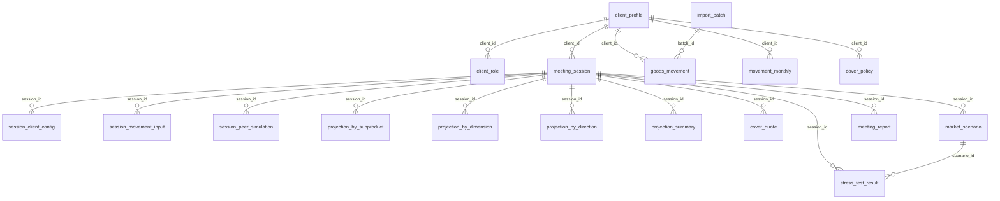

# DB schema (approximate, from migrations)

> Generated from `migrations V*.sql, R*.sql under /db/migration/` by `scripts/docs` (regex scan, no build required). Do not edit by hand.
21 table(s). Derived by regex from migrations - types/constraints are indicative; verify against a real DB for DDL work.

## `client_profile`
Created in `harbor-core/src/main/resources/db/migration/V1__clients.sql`
Used in: `ClientManager`, `ClientProfile`, `ClientProfileRepository`, `ClientProfileService`

| Column | Type / flags |
|---|---|
| `id` | uuid PK |
| `external_ref` | varchar(64) NN |
| `name` | varchar(200) NN |
| `country` | varchar(3) |
| `segment` | varchar(64) |
| `created_at` | timestamp NN |

## `client_role`
Created in `harbor-core/src/main/resources/db/migration/V1__clients.sql`
Used in: `ClientRoleDecision`, `ClientRoleRepository`, `ClientRoleService`, `ClientRoleSessionClosedListener`

| Column | Type / flags |
|---|---|
| `id` | bigserial PK |
| `client_id` | uuid NN FK->client_profile |
| `product_group` | varchar(16) NN |
| `role` | varchar(16) NN |
| `source` | varchar(16) NN |
| `reason` | varchar(500) |
| `decided_at` | timestamp NN |

## `meeting_session`
Created in `harbor-core/src/main/resources/db/migration/V2__meetings.sql`
Used in: `MeetingSession`, `MeetingSessionRepository`

| Column | Type / flags |
|---|---|
| `id` | uuid PK |
| `client_id` | uuid NN FK->client_profile |
| `product_group` | varchar(16) NN |
| `kind` | varchar(16) NN |
| `representative_id` | varchar(64) NN |
| `status` | varchar(16) NN |
| `started_at` | timestamp NN |
| `closed_at` | timestamp |
| `role_override` | varchar(16) |
| `role_override_reason` | varchar(500) |
| `parameter_snapshot` | jsonb |
| `report_requested_at` | timestamp (+harbor-core/src/main/resources/db/migration/V9__parameters.sql) |

## `session_client_config`
Created in `harbor-core/src/main/resources/db/migration/V2__meetings.sql`
Used in: `SessionClientConfig`, `SessionClientConfigRepository`

| Column | Type / flags |
|---|---|
| `session_id` | uuid PK FK->meeting_session |
| `horizon_months` | integer NN |
| `price_basis` | varchar(3) NN |
| `cover_preference` | varchar(16) NN |

## `import_batch`
Created in `harbor-core/src/main/resources/db/migration/V3__movements.sql`
Used in: `ImportBatch`, `ImportBatchRepository`, `ImportManager`, `MovementImportService`

| Column | Type / flags |
|---|---|
| `id` | uuid PK |
| `source_file` | varchar(255) NN |
| `received_at` | timestamp NN |
| `rows_total` | integer NN |
| `rows_rejected` | integer NN |
| `status` | varchar(16) NN |

## `goods_movement`
Created in `harbor-core/src/main/resources/db/migration/V3__movements.sql`
Used in: `DailyMovementImportJob`, `GoodsMovement`, `GoodsMovementRepository`, `ImportManager`, `MonthlySnapshotJob`, `MovementImportService`, `MovementMonthly`

| Column | Type / flags |
|---|---|
| `id` | bigserial PK |
| `client_id` | uuid NN FK->client_profile |
| `batch_id` | uuid NN FK->import_batch |
| `product_group` | varchar(16) NN |
| `sub_product` | varchar(16) NN |
| `city` | varchar(64) |
| `transport_mode` | varchar(8) |
| `direction` | varchar(3) NN |
| `period` | date NN |
| `quantity` | numeric(18, 4) NN |
| `unit_price` | numeric(18, 4) NN |
| `price_basis` | varchar(3) NN |

## `movement_monthly`
Created in `harbor-core/src/main/resources/db/migration/V3__movements.sql`
Used in: `ClientOverviewIndicators`, `ClientOverviewService`, `ClientRoleService`, `CoverRatioService`, `GoodsMovementRepository`, `ImportManager`, `MonthlySnapshotJob`, `MovementImportService`, `MovementMonthly`, `MovementMonthlyRepository`, `ProjectionInputAssembler`, `SessionPeerSimulation`

| Column | Type / flags |
|---|---|
| `id` | bigserial PK |
| `client_id` | uuid NN FK->client_profile |
| `product_group` | varchar(16) NN |
| `sub_product` | varchar(16) NN |
| `city` | varchar(64) |
| `transport_mode` | varchar(8) |
| `direction` | varchar(3) NN |
| `period` | date NN |
| `quantity` | numeric(18, 4) NN |
| `value` | numeric(18, 2) NN |

## `session_movement_input`
Created in `harbor-core/src/main/resources/db/migration/V4__session_inputs.sql`
Used in: `ProjectionInputAssembler`, `SessionMovementInput`, `SessionMovementInputRepository`

| Column | Type / flags |
|---|---|
| `id` | uuid PK |
| `session_id` | uuid NN FK->meeting_session |
| `period` | date NN |
| `sub_product` | varchar(16) NN |
| `city` | varchar(64) |
| `transport_mode` | varchar(8) |
| `direction` | varchar(3) NN |
| `quantity` | numeric(18, 4) NN |
| `unit_price` | numeric(18, 4) NN |

## `session_peer_simulation`
Created in `harbor-core/src/main/resources/db/migration/V4__session_inputs.sql`
Used in: `PeerSimulationService`, `SessionPeerSimulation`, `SessionPeerSimulationRepository`

| Column | Type / flags |
|---|---|
| `id` | uuid PK |
| `session_id` | uuid NN FK->meeting_session |
| `peer_segment` | varchar(64) NN |
| `scaling_factor` | numeric(8, 4) NN |
| `generated_at` | timestamp NN |

## `projection_by_subproduct`
Created in `harbor-core/src/main/resources/db/migration/V5__projection.sql`
Used in: `ProjectionRepository`, `ProjectionRow`

| Column | Type / flags |
|---|---|
| `id` | bigserial PK |
| `session_id` | uuid NN FK->meeting_session |
| `period` | date NN |
| `sub_product` | varchar(16) NN |
| `quantity` | numeric(18, 4) NN |
| `value` | numeric(18, 2) NN |
| `landed_cost` | numeric(18, 2) NN |
| `cumulative_value` | numeric(18, 2) NN |

## `projection_by_dimension`
Created in `harbor-core/src/main/resources/db/migration/V5__projection.sql`
Used in: `ProjectionRepository`, `ProjectionRow`

| Column | Type / flags |
|---|---|
| `id` | bigserial PK |
| `session_id` | uuid NN FK->meeting_session |
| `period` | date NN |
| `dimension_kind` | varchar(16) NN |
| `dimension_value` | varchar(64) NN |
| `quantity` | numeric(18, 4) NN |
| `value` | numeric(18, 2) NN |
| `landed_cost` | numeric(18, 2) NN |
| `cumulative_value` | numeric(18, 2) NN |

## `projection_by_direction`
Created in `harbor-core/src/main/resources/db/migration/V5__projection.sql`
Used in: `ProjectionRepository`, `ProjectionRow`

| Column | Type / flags |
|---|---|
| `id` | bigserial PK |
| `session_id` | uuid NN FK->meeting_session |
| `period` | date NN |
| `direction` | varchar(3) NN |
| `quantity` | numeric(18, 4) NN |
| `value` | numeric(18, 2) NN |
| `landed_cost` | numeric(18, 2) NN |
| `cumulative_value` | numeric(18, 2) NN |

## `projection_summary`
Created in `harbor-core/src/main/resources/db/migration/V5__projection.sql`
Used in: `ProjectionRepository`, `ProjectionRow`

| Column | Type / flags |
|---|---|
| `id` | bigserial PK |
| `session_id` | uuid NN FK->meeting_session |
| `period` | date NN |
| `total_quantity` | numeric(18, 4) NN |
| `total_value` | numeric(18, 2) NN |
| `total_landed_cost` | numeric(18, 2) NN |
| `cover_ratio` | numeric(7, 4) NN |
| `cumulative_value` | numeric(18, 2) NN |

## `cover_policy`
Created in `harbor-core/src/main/resources/db/migration/V6__cover.sql`
Used in: `CoverPolicy`, `CoverPolicyRepository`, `CoverRatioService`

| Column | Type / flags |
|---|---|
| `id` | uuid PK |
| `client_id` | uuid NN FK->client_profile |
| `product_group` | varchar(16) NN |
| `sub_product` | varchar(16) |
| `covered_share` | numeric(7, 4) NN |
| `premium_rate` | numeric(9, 6) NN |
| `valid_from` | date NN |
| `valid_to` | date |

## `cover_quote`
Created in `harbor-core/src/main/resources/db/migration/V6__cover.sql`
Used in: `CoverManager`, `CoverQuote`, `CoverQuoteRepository`, `CoverQuoteService`

| Column | Type / flags |
|---|---|
| `id` | uuid PK |
| `session_id` | uuid NN FK->meeting_session |
| `requested_at` | timestamp NN |
| `uncovered_value` | numeric(18, 2) NN |
| `premium` | numeric(18, 2) NN |
| `provider_ref` | varchar(128) |

## `market_scenario`
Created in `harbor-core/src/main/resources/db/migration/V7__market_stress.sql`
Used in: `MarketScenario`, `MarketScenarioRepository`, `ScenarioService`

| Column | Type / flags |
|---|---|
| `id` | uuid PK |
| `session_id` | uuid NN FK->meeting_session |
| `name` | varchar(120) NN |
| `kind` | varchar(16) NN |
| `shocks` | jsonb NN |
| `created_by` | varchar(64) NN |
| `created_at` | timestamp NN |

## `baseline_price`
Created in `harbor-core/src/main/resources/db/migration/V7__market_stress.sql`
Used in: `BaselinePrice`, `BaselinePriceRepository`, `BaselinePriceService`, `MarketManager`, `MarketPricesListener`, `ProjectionAggregator`

| Column | Type / flags |
|---|---|
| `id` | bigserial PK |
| `product_group` | varchar(16) NN |
| `corridor` | varchar(8) NN |
| `period` | date NN |
| `price` | numeric(18, 4) NN |
| `transport_price` | numeric(18, 4) NN |
| `as_of` | timestamp NN |

## `stress_test_result`
Created in `harbor-core/src/main/resources/db/migration/V7__market_stress.sql`
Used in: `ReportManager`, `ReportPayloadService`, `StressDimension`, `StressManager`, `StressTestResult`, `StressTestResultRepository`

| Column | Type / flags |
|---|---|
| `id` | bigserial PK |
| `session_id` | uuid NN FK->meeting_session |
| `scenario_id` | uuid NN FK->market_scenario |
| `period` | date NN |
| `dimension_value` | varchar(64) NN |
| `exposure` | numeric(18, 2) NN |
| `transport_cost_delta` | numeric(18, 2) NN |
| `cumulative_exposure` | numeric(18, 2) NN |

## `meeting_report`
Created in `harbor-core/src/main/resources/db/migration/V8__reports.sql`
Used in: `MeetingReport`, `MeetingReportRepository`, `ReportManager`

| Column | Type / flags |
|---|---|
| `session_id` | uuid PK FK->meeting_session |
| `payload` | jsonb NN |
| `pdf_path` | varchar(512) |
| `status` | varchar(16) NN |
| `rendered_at` | timestamp |

## `parameter_set`
Created in `harbor-core/src/main/resources/db/migration/V9__parameters.sql`
Used in: `ClientRoleService`, `MeetingManager`, `MeetingSession`, `MissingParameterException`, `Parameter`, `ParameterRepository`, `ParameterService`, `ProjectionAggregator`, `ProjectionInputAssembler`, `RoleClassifier`

| Column | Type / flags |
|---|---|
| `id` | uuid PK |
| `key` | varchar(64) NN |
| `scope_product_group` | varchar(16) |
| `scope_country` | varchar(3) |
| `scope_value` | varchar(64) |
| `value` | numeric(18, 6) NN |
| `valid_from` | date NN |
| `updated_by` | varchar(64) NN |
| `updated_at` | timestamp NN |

## `shedlock`
Created in `harbor-core/src/main/resources/db/migration/V10__shedlock.sql`
Used in: `SchedulingConfig`

| Column | Type / flags |
|---|---|
| `name` | varchar(64) PK NN |
| `lock_until` | timestamp NN |
| `locked_at` | timestamp NN |
| `locked_by` | varchar(255) NN |

## Views
Statistical / reporting views defined next to the migrations (not versioned by Flyway; applied by the application or by hand).

| View | Columns | From tables | Source |
|---|---|---|---|
| `v_client_overview` | `client_id`, `external_ref`, `name`, `country`, `open_sessions`, `last_session_at` | `client_profile`, `meeting_session` | `harbor-core/src/main/resources/db/migration/statistical-views/create_view_client_overview.sql` |
