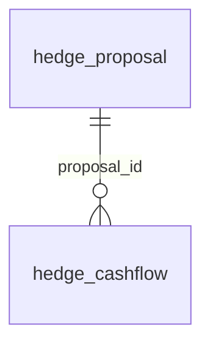

# DB schema (approximate, from migrations)

> Generated from `Flyway V*.sql` by `scripts/docs` (regex scan, no build required). Do not edit by hand.
2 table(s). Derived by regex from migrations - types/constraints are indicative; verify against a real DB for DDL work.

## `hedge_proposal`
Created in `hedges/src/main/resources/db/migration/V1__hedges_init.sql`

| Column | Type / flags |
|---|---|
| `id` | UUID PK |
| `client_id` | VARCHAR(32) NN |
| `notional` | NUMERIC(18, 2) NN |
| `fixed_rate` | NUMERIC(9, 6) NN |
| `start_month` | DATE NN |
| `end_month` | DATE NN |
| `status` | VARCHAR(16) NN |
| `created_at` | TIMESTAMPTZ NN |
| `advisor_id` | VARCHAR(32) (+hedges/src/main/resources/db/migration/V2__hedges_advisor.sql) |
| `stress_shift_bp` | INTEGER DEFAULT 0 (+hedges/src/main/resources/db/migration/V2__hedges_advisor.sql) |

## `hedge_cashflow`
Created in `hedges/src/main/resources/db/migration/V1__hedges_init.sql`

| Column | Type / flags |
|---|---|
| `proposal_id` | UUID NN FK->hedge_proposal |
| `month` | DATE NN |
| `amount` | NUMERIC(18, 2) NN |

