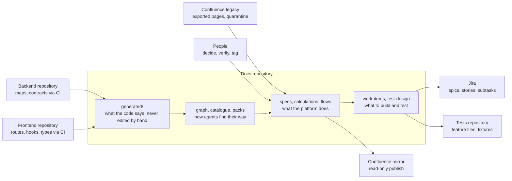
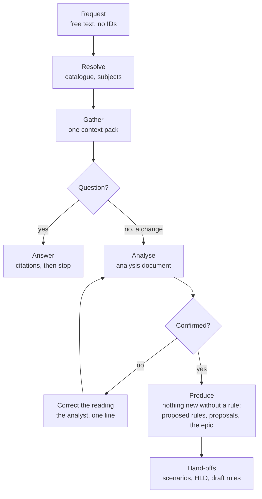

# Harbor documentation repository: concept and way of working

2026-10-20 · Markdown export of the living document written with Claude from the repository as it stands; the
pictures are redrawn as Mermaid here.

## What the repository is

The docs repository is the single source of truth for what the Harbor platform does and how it is built, written so that an AI agent can answer an analyst's question or slice a request into Jira stories without reading application code. Harbor is the sample platform of the prototype: account representatives meet clients, review product movements, model projections, offer cover, run market scenarios and stress tests, and close with a report.

It replaces the usual state of affairs - knowledge spread over Confluence pages of unknown age, Jira tickets and the heads of two developers - with one Git repository where every document is a **concept** with a YAML header that says what it is, where its facts came from, who verified them and when they go stale. The format is the Open Knowledge Format (OKF v0.2): every folder has a generated `index.md`, so an agent orients through indexes, never through directory listings.

Three things feed it and three things come out of it:

| Direction | System | What crosses the boundary |
| --- | --- | --- |
| in | backend and frontend code repositories | generated maps of the code, the OpenAPI and AsyncAPI contracts, the database schema - produced by scripts in those repos' CI, collected into `generated/` |
| in | Confluence (legacy) | exported pages, kept in quarantine until an agent has merged their facts into a spec |
| in | people | decisions, verification, open questions answered |
| out | Jira | epics, stories and subtasks with Gherkin acceptance criteria (`work-items/`) |
| out | tests repository | Gherkin feature files and synthetic fixtures (`test-design/`) |
| out | Confluence | a read-only published mirror of the specs |

The repository holds no secrets and no client data: everything in it is synthetic, and the code repositories stay where they are - the docs repo only knows their shape.

The constraints it was built under: GitHub Copilot in VS Code, JetBrains and the CLI is the only AI tooling (no MCP servers, no agent frameworks), every script is Python 3.11 standard library, and nothing an agent writes is trusted until a person has reviewed it.



The code repositories and Confluence feed the left; people verify in the middle; Jira, the tests repository and the Confluence mirror read from the right - nothing flows back into `generated/` except through a code repository.

## What it contains

The repository is cut by **bounded context** - a business area that is a family of class-name prefixes in the backend plus a page folder in the frontend (`contexts.yml`): clients, meetings, imports, product1, product2, cover, market, stress, reports, admin, presentation. Each context gets a spec prefix (`CLI`, `SES`, `P1`, `STR`...) and its documents sit in a folder of that name.

| Folder | Holds | Written by | Identified by |
| --- | --- | --- | --- |
| `features/<context>/` | feature specs: one per user capability (the main screen is `<CTX>-001`, each modal or sub-capability with its own rules gets the next number); Summary, Actors, Business rules, UI flow, API / Events, Data, Calculations, Edge cases, Open questions, Change log | spec-writer, confluence-migrator, doc-sync, people | spec ID `P1-002`; rules `BR-P1-002-3` |
| `domain/calculations/` | one concept per formula: inputs, parameters, outputs, formula, the sanctioned code shape, worked examples copied from the unit test, an audit table | doc-sync, calc-auditor | snake_case name `stress_test_monthly` |
| `domain/glossary.md`, `domain/context-map.md` | the canonical vocabulary with aliases (what people also say), the map of contexts | people, confluence-migrator | the term |
| `flows/` | behaviour that crosses contexts: the meeting journey, the presentation window, what is recomputed when inputs change - each names the specs it composes | spec-writer | `flows/<name>.md` |
| `architecture/` | C4 overview, integration map, ADRs, high-level designs per feature or request | architect | `adr/NNNN-<slug>`, `hld/<ID>` |
| `contracts/proposed/` | operations designed before any code exists (OpenAPI / AsyncAPI), cited as **proposed** until the collector brings the implemented contract | analyst, architect | `<ID>.openapi.yaml`, `<request-slug>.openapi.yaml` |
| `generated/` | what the code says, never edited by hand: `be/` and `fe/` maps (classes, endpoints, events, schema, routes, datasets, parameters), `openapi/` and `asyncapi/` contracts (with the Kafka payload schemas under `asyncapi/schemas/`), `graph/` (the architectural graph, one page per context), `catalogue.md`, `analytics/` | the collector and the docs scripts | - |
| `work-items/` | Jira epics as YAML: one per spec (`<ID>.yml`) or one per analyst request (`<slug>.yml` with its analysis `<slug>.md`) | analyst | spec ID or request slug |
| `test-design/` | Gherkin feature files per spec and synthetic fixtures | test-designer | `<ID>.feature` |
| `confluence-import/` | the quarantine: exported legacy pages with their provenance headers, `_done/` for the ones already merged | the import script, confluence-migrator | Confluence page id |
| `migration/` | the migration board: per context which lifecycle runs are still due, with the command for each | migration-lead | `<scope>.md` |
| `.github/` | the agents (`agents/`), one-shot prompts (`prompts/`), procedures (`skills/`), instructions per folder, hooks and CI workflows | the platform team | - |
| `scripts/` | the tooling (next sections) | the platform team | - |
| `AGENTS.md`, `README.md`, `index.md`, `log.md` | the rules every agent reads first, the human entry point, the root index, the dated update log | the platform team, every agent on a lifecycle event | - |

A few conventions decide where a fact lives. Contexts follow the code, not the menu. A rule belongs to exactly one spec; behaviour that spans contexts is a flow, never a rule repeated in two specs. Product types are a dimension of a spec unless the code has a class family for them (Harbor has `Product1*` and `Product2*`, so Product 2 has mirrored specs whose rules read "as BR-P1-001-n"). Worked numbers live in calculation concepts, never in a spec. A spec stays under 300 lines and 12 rules; beyond that a capability is carved out into the next ID.

## Where the knowledge comes from

The code is the truth, legacy pages are evidence, and people decide. Every fact in a spec can be traced to one of the three, and the trust badge on each concept says how far that tracing has gone.

**From the code.** Each code repository carries a small kit of generator scripts (`scripts/docs/`, standard-library Python, config-driven through `docs-gen.json`) that CI runs on every merge: they scan the source with regular expressions - no build - and write maps of classes with their layer and dependencies, REST handlers with their operationId, Kafka listeners and producers with their topics, Flyway tables with the comments from the migrations, scheduled jobs, admin parameters, named datasets, frontend routes, hooks, components and types, plus the `@docs <ID>` tags developers put on entry points. The docs repo's **collector** (`collect-evidence.py`) copies those maps and the contracts into `generated/`, records the source commits in a manifest, and rebuilds the **graph** (`gen-graph.py`: about 300 nodes for Harbor - contexts, classes, endpoints, tables, topics, pages, hooks, specs - with `depends-on`, `persists-to`, `exposes`, `calls` edges, one community per context), the **catalogue** and the indexes. Nothing under `generated/` is ever edited by hand; a wrong fact there is fixed in the generator or in the code.

**From Confluence.** The legacy space is exported as HTML and imported into the quarantine (`confluence-import.py`): one Markdown file per page with its author, date and tree position, images beside it. A page is never authoritative. The confluence-migrator merges its new facts into the spec, cites the page as a source, marks what the code contradicts with a `⚠️ CONFLICT` callout and what nothing confirms with `❓ UNVERIFIED`, and moves the page to `_done/`. Numbers on a legacy page are never copied; the calculation concept is linked and audited against the unit test instead.

**From people.** Owners answer the open questions, decide conflicts, and verify: `verified: { by: human:<id>, at }` on a concept is the one line no agent may write. Developers tag entry points with `@docs`, keep `contexts.yml` current when a class-name prefix or page appears, and bump `last_verified` when a PR touches mapped code (the freshness gate in the code repos' CI).

The **trust badge** is computed from the header and shown in every index and context pack:

| Badge | Meaning |
| --- | --- |
| `human-reviewed` | a person verified it (`verified.by: human:…`); status usually `stable` |
| `machine-confirmed` | a script or agent confirmed it against the code (an audit with all rows MATCH); still awaiting a person |
| `draft · unverified` | written by an agent or imported, nobody confirmed it; stories derived from it carry `needs-spec-review` |
| `STALE` | `stale_after` has passed; re-verify before use |

Every concept also carries `generated: { by: copilot/<agent> | process:<script> | human:<id>, at }`, `sources[]` with the files, pages or commits it was written from, and footnotes that cite them. An agent that cannot source a claim writes it as an open question, not as prose.

## The tooling

Everything is a plain Python 3.11 script under `scripts/` with long flags, no packages, no network except the four stubs that talk to Jira, Confluence and the tests repository. Each script writes one thing and can check it (`--check` exits 1 in CI when its output is stale).

| Script | Produces | Used by |
| --- | --- | --- |
| `collect-evidence.py` | `generated/be`, `generated/fe`, contracts, `generated/manifest.yml`; with `--graph` also the graph, the catalogue and the indexes; one PR per evidence snapshot | CI of the docs repo, the platform team |
| `gen-graph.py`, `graph-query.py`, `graph-viewer.py` | `generated/graph/` (graph.json, one page per context, the ranked `REPO_MAP.md`); neighbourhood of a node, blast radius of changed files, a browser page of the whole graph | every agent, developers, the impact analyst |
| `gen-catalogue.py` | `generated/catalogue.md`: one line per context, flow, spec with aliases, calculation with parameters, endpoint, topic, table, external service and glossary alias | the analyst resolving a free-text request |
| `context-pack.py` | `.context/<task>.md`: the task-scoped pack for one or several subjects - spec body, calculations with worked examples, flows, graph neighbourhood with `file:line`, contract operations, table pages, datasets, work items, tests, legacy pages that mention the subject | every agent, before anything else |
| `build-index.py` | every `index.md` with one line and the trust badge per concept | agents orienting, CI |
| `okf-validate.py`, `validate-frontmatter.py`, `validate-work-items.py` | errors on a malformed bundle, spec or work-item file | the stop hook, CI, agents once after the last edit of a task, for what they changed |
| `coverage-matrix.py` | `generated/analytics/coverage-matrix.md`: which rules have stories and scenarios, badges, audits | the analyst's analytics mode, management |
| `migration-status.py` | `migration/<scope>.md`: the lifecycle runs still due per context with the command for each | the migration lead |
| `legacy-done.py` | moves a processed legacy page to `confluence-import/<SPACE>/_done/<section>/`, writes `status`, the date and `superseded_by` (every concept it went into), re-points its links | the agent that takes the page last |
| `map-paths.py`, `check-freshness.py` | changed code paths to affected specs (`docs-map.yml`); the CI gate in the code repos when mapped code changed but no spec was re-verified | doc-sync, the code repos' CI |
| `confluence-import.py` | the quarantine pages from an HTML export, idempotent | the migration lead |
| `jira-push.py`, `confluence-publish.py`, `push-to-tests-repo.py`, `confluence-export.py` | stubs that describe the REST calls | integration, when wired |
| `hooks/guard-generated.py` | denies any agent edit under `generated/**` or of an `index.md` | the Copilot pre-tool hook |

The **context pack** is the centre of the design. An agent starts from one pack built for its task, not from a search; after it the analyst opens the documentation folders freely while other agents open the files their procedure names, and code is opened at most at the `file:line` the pack names (the analyst, when the pack leaves a question open, may locate up to five ranges itself through the generated maps, and for a question that still blocks its answer reads the code freely; it records what it reads as evidence and an open question, never as a rule, and the coverage matrix counts those questions per spec as documentation gaps). A pack is deterministic, reviewable (it can be attached to a PR) and carries provenance. Its sections come in a fixed order the agents refer to by name: Subject, Spec (or Calculation, Flow, Context overview), Calculations, Flows, Graph neighbourhood, Contracts, Data, Related work items and tests, Legacy pages, Sources and limits. Several subjects make one pack with the shared sections merged.

**CI** in the docs repo validates the bundle, checks that indexes, graph, catalogue and coverage matrix are up to date, and comments the specs in the blast radius of a changed `generated/` file on each PR. Two **Copilot hooks** run locally: before any tool use the guard above, and when an agent stops the indexes rebuild and the three validators run - an agent cannot finish with a broken bundle.

## The agents

Nine Copilot agents do the writing; each has one job, a fixed list of what it may read, and hand-off buttons to the next one. A person reviews every diff an agent produces and commits it; agents never call each other, never read source code beyond the one range a pack names, and never write a human verification.

| Agent | Job | Reads | Writes | Hands off to |
| --- | --- | --- | --- | --- |
| `analyst` | answers questions with rule citations; turns a spec or a free-text request into an analysis document and Jira-ready epic, stories, subtasks; documentation analytics | the catalogue and one context pack | `work-items/<ID or slug>.yml`, `work-items/<slug>.md`, open questions, contract proposals | `test-designer`, `spec-writer` (draft rules), `architect` (HLD) |
| `spec-writer` | creates or refreshes a spec: structure from the graph and contracts, prose from one manager file | the pack, `generated/graph/<ctx>.md`, `manager/<Ctx>Manager.kt` only | `features/<ctx>/<ID>.md`, `docs-map.yml` | `analyst`, `calc-auditor` |
| `doc-sync` | keeps specs in sync when code changes: maps changed paths to specs, compares API / Events / Data with the new contracts, appends change-log rows, promotes implemented proposals | the generated diff, the pack, a narrow `file:line` when behaviour changed | the affected specs, `docs-map.yml`, calculation status | `calc-auditor` when a formula file changed |
| `calc-auditor` | verifies a calculation concept against the calculator class and its unit test; findings as MATCH / DOC-STALE / CODE-SUSPECT rows | the concept, one class and one test | the `## Audit` table, worked examples, open questions; never a number silently | `spec-writer`, `doc-sync`, `confluence-migrator` for the screen rules of a mixed legacy page |
| `test-designer` | Gherkin scenarios and synthetic fixtures from the rules, worked examples and graph-derived test scope | the pack, `test-design/README.md` | `test-design/features/<ID>.feature`, fixtures, the spec's `tests:` list | - |
| `architect` | C4 views, HLDs, ADRs, the integration map; legacy architecture, decision and process pages | `architecture/`, the graph, contracts, spec headers, the legacy page | `architecture/**`, glossary, `_done/` | `confluence-migrator` / `calc-auditor` for a page's feature or formula part |
| `impact-analyst` | blast radius of a change from the graph only: docs, Jira and test checklist | `generated/graph/` | a checklist | - |
| `confluence-migrator` | merges one legacy page into the bundle, verifying claims against `generated/`, flagging conflicts, extracting glossary terms | the page, the pack, `generated/` | the target spec, glossary, `_done/` | `calc-auditor` for formula pages, `architect` for architecture, decision and process pages |
| `migration-lead` | plans and tracks the migration: which runs are due per context, in which order, with the command | `migration-status.py` output | `migration/<scope>.md` | the agents of each run |

Around them: **prompts** (`/analyse-request`, `/jira-from-spec`, `/spec-skeleton-from-graph`, `/spec-from-code`, `/tests-from-spec`, `/hld-from-spec`, `/impact-from-graph`, `/audit-calculation`, `/migration-plan`, `/coverage-report`, `/okf-validate`...) are one-shot entries into an agent with the arguments filled; **skills** (`task-context`, `write-feature-spec`, `calculation-spec`, `jira-work-items`, `gherkin-test-design`, `code-graph`, `spec-lifecycle`, `legacy-page-audit`, `docs-analytics`, `okf`) are the procedures and reference tables the agents follow; **instructions** per folder apply the rules to whatever file is being edited. `AGENTS.md` is read by every tool first and holds the hard rules.

The one rule that makes the rest possible: an agent works from the pack, not from the repository. When the pack does not answer, it rebuilds the pack with another subject, follows one `file:line`, or records an open question - never a guess.

## The spec lifecycle

A spec is written part by part: one agent run per part, a human review of the diff after each run, one commit per run. The code comes first, the Confluence pages are merged into it afterwards, and a person closes the loop.

1. **Skeleton** - `spec-writer` via `/spec-skeleton-from-graph <ctx> <ID>`: API / Events, Data, UI flow and Calculations from the graph and contracts; Summary, Actors and Business rules from the one manager file. Exit: `status: draft`, open questions listed.
2. **Legacy merge** - `confluence-migrator`, one page per run: the specs the page touches named from the catalogue (a page often describes several contexts; each fact goes to the spec of the context that owns the behaviour, a cross-context sequence to a flow), new facts merged and cited, conflicts and unverifiable claims flagged, glossary terms added, the page moved to `_done/` once every context it describes has a spec. The migrator never creates a spec: a capability no spec covers becomes a `candidate spec:` open question (`in code` or `not in code`), the lead and a developer confirm it, Run 1 writes it from the code - or, for behaviour still to be built, the analyst drafts it from the page as a request with proposed rules (`/analyse-request`) - under the next free number, never by renumbering the context's specs, and the page is rerun. Exit: every legacy claim cited.
3. **Calculation audit** - `calc-auditor` via hand-off or `/audit-calculation <name>`: the concept against the calculator and its unit test, worked examples copied from the test. Exit: the calculation is `stable` only when every audit row is MATCH.
4. **Owner decision** - a person: answers the open questions, decides the conflicts, adds `verified: { by: human:<id>, at }` and `stale_after`. Exit: `status: stable`, badge human-reviewed.
5. **Ongoing** - `doc-sync` on every evidence snapshot: change-log row, `last_verified`; back to `draft` when a rule changed.

`migration-status.py --scope <ctx>` says deterministically which run a context is in and writes the board `migration/<scope>.md`; the migration lead works it top down: every skeleton first (they can be batched through the Copilot coding agent, one issue per context), then legacy pages one by one, audits as hand-offs, owner decisions as they come.

A context is **ready for the analyst** when the graph shows no "code only" entry for it, its specs are stable and verified, every linked calculation has an audited concept with worked examples, no legacy page of the context remains outside `_done/` and no candidate spec is pending (architecture pages belong to `architect`, not to a context), the validators pass, and a single-spec pack carries everything within budget. Trust grows run by run and is visible at a glance in every index - and anything an agent derives from a context that is not there yet carries the label `needs-spec-review`.

## How the analyst works

An analyst talks to the agent the way they talk to a colleague: a question, or a request in free text that names no ID and may span several contexts and mix existing with new behaviour. The agent works in four moves and stops once to confirm it understood.

1. **Resolve.** It reads the catalogue and decides which lines the request is about - a flow plus two specs, an existing calculation plus a new one, a context that has code but no spec yet. A part that matches no line is new work, placed in the context it belongs to. It decides whether this is a question or a change request.
2. **Gather.** It builds one context pack with a `--task` per subject (`--task P1-002 --task STR-001 --task flows/session-inputs-recalculation.md --task context:cover`). A context subject brings an overview of what that context already has - endpoints, tables, calculations, topics, classes by layer, pages - so a new piece can be placed next to the nearest existing one. For a change request it reads the pack top to bottom: every section feeds the epic and the analysis document cites it. For a question it takes the narrowest subject that answers it (the calculation for "how is it computed", the spec for "what does the screen show", the flow for "in which order"), a budgeted pack of 200 lines, and reads the Subject and the section the question names; the other sections stay pointers it follows only when the answer needs them. The bundle's progressive disclosure holds inside the pack, not only around it.
3. **Analyse.** For a question it answers from the section it read, searching the documentation folders for the term when that section does not answer and rebuilding the pack only for a structural or multi-subject question; every statement citing a rule, a calculation, a flow step or an operation, with facts, unverified claims and unknowns kept apart - and stops. For a change request it writes the analysis document `work-items/<slug>.md`: the request verbatim, its reading in glossary terms ending with *I read this as: ... - right?*, a parts table where each piece is **unchanged** (cite the rule), **changed** (which rule, screen, endpoint or table) or **new** (nothing in the bundle does it), with evidence from the pack only; then trust, what is reused / changed / built, contracts, data, flows, calculations, gaps. It shows the reading and the parts table and **waits** for the analyst's yes or correction.
4. **Produce.** Nothing new without a rule: a new behaviour gets a **proposed** rule in its spec (`BR-P1-001-12 proposed (request quarterly-view-across-products)`), a new behaviour in a context without a spec gets that context's first draft spec, a new operation a proposal under `contracts/proposed/`, a new calculation a draft concept with the formula open, a new service an ADR. Only then the epic: one file, stories that may cite rules of several specs, the story that creates a contract or table first and the others depending on it, every acceptance criterion in Gherkin citing a rule that exists, subtasks derived per graph node kind (`[BE]` endpoint, `[DB]` table, `[INT]` topic, `[FE]` page, `[TEST]`), estimates, open questions. The validator checks it; the coverage matrix counts the stories for every spec they cite.



A question ends at the answer; a change request goes through the analysis document, the analyst's confirmation (corrections loop back into the analysis), the gate that every new part has a rule, and only then the epic and the hand-offs.

Two shapes of epic come out: a **feature epic** `work-items/<ID>.yml` when the work is one spec (`/jira-from-spec P1-002`), a **request epic** `work-items/<slug>.yml` with its analysis beside it when the request spans specs (`/analyse-request "..."`). From there the hand-offs: `test-designer` writes scenarios into each spec's feature file, `architect` writes the HLD from the analysis document, `spec-writer` drafts the rules the analysis asked for.

**Worked example** (from the acceptance run). Request: *"Let the representative switch the Product 1 and Product 2 overviews to a quarterly view and carry it into the stress test table."* Reading: P1-001 + P2-001 + STR-001 + PRS-001 (the client window mirrors the product and stress pages) + a new roll-up calculation. Parts: the three tables are **changed** (one row per month today, BR-P1-001-1, BR-STR-001-3), the mirror is **changed** (the `view` message carries no period, BR-PRS-001-4), the roll-up is **new** (pattern: `horizon_totals`, derived at read time, never stored), the horizon totals and the monthly storage are **unchanged**, the report is a **question** for the owner. Produced: four proposed rules, the draft concept `quarterly_rollup`, a proposal adding `period = MONTH | QUARTER` to five operations, and an epic of four stories (roll-up, product pages, stress page, mirror) with four open questions. A second request - a premium estimate on the cover chart - stopped at the gate: the cover context has no spec, so the analysis names COV-001 as the first step and asks the owner what the estimate is.

The analyst never names a context or an ID; the catalogue, the glossary aliases (customer - client, lane - corridor, coverage - cover ratio) and the confirmation line carry that. A wrong reading caught at the confirmation costs one line; caught after the stories it would cost the epic.

## People and roles

The agents write; people decide, review and own. Six roles cover the process; in a small team one person holds several.

| Role | Does | Owns in the repo |
| --- | --- | --- |
| Domain owner (per context) | answers open questions, decides conflicts between code and legacy pages, verifies specs and calculations (`verified.by: human:<id>`), decides what a proposed rule means (Run 4) | `features/<ctx>/`, the context's rows in the glossary |
| Migration lead | plans the migration from the board, runs the skeleton batch, feeds legacy pages one by one to the migrator, keeps `migration/` current, reports progress per context | `migration/`, `confluence-import/`, `contexts.yml` with the dev lead |
| Dev lead / developers | keep the generator kits in the code repos, tag entry points with `@docs`, keep `contexts.yml` and `docs-map.yml` current, respect the freshness gate (bump `last_verified` or label `docs-not-affected`), review doc-sync and calc-auditor diffs for technical truth | the code repos' `scripts/docs/`, `generated/` through CI |
| Analyst | brings questions and requests, confirms the agent's reading, reviews the analysis and the epic, decides the open questions the owner delegates, pushes to Jira | `work-items/`, `contracts/proposed/` with the architect |
| Tester / QA architect | reviews the generated scenarios and fixtures, keeps the step vocabulary in `test-design/README.md`, pushes to the tests repository | `test-design/` |
| Architect | HLDs and ADRs for requests that add a service or an integration, the integration map, the C4 views | `architecture/` |
| Platform team | the repo's rules, scripts, agents, skills, CI and hooks; the change list for other teams adopting the setup | `AGENTS.md`, `scripts/`, `.github/`, templates |

Three duties are not delegable to an agent: the human verification line, the merge of any PR an agent produced, and the answer to an open question. The review is cheap by design - one run changes one part of one spec, the diff is small, the pack it was written from is attached - and that is what keeps the trust badges honest.

## Day-to-day flows

Six situations cover the daily work; each is a short chain of one script, one agent and one human review.

**A code change lands.** The code repo's CI regenerates its maps; the freshness gate fails the PR when a mapped path changed and no spec was re-verified. On merge the collector takes a snapshot and opens one PR in the docs repo with the specs in its blast radius listed. `doc-sync` works that PR: maps changed paths to specs, compares the contract and schema diffs with the API / Events / Data sections, updates the specs with a change-log row, flags a changed calculator to `calc-auditor`, promotes a proposal whose operation now exists. A person reviews and merges.

**A request arrives in free text.** `/analyse-request "..."` - catalogue, one pack, analysis document, the reading confirmed by the analyst, proposed rules and proposals, the request epic, validation. Hand-offs: scenarios, HLD, draft rules. Then `jira-push.py` creates the epic, stories and subtasks and writes the keys back.

**A question.** The same first two moves, then an answer with citations and a trust badge per source; what the bundle cannot answer becomes an evidence request in the spec's open questions - never a guess.

**Test design.** `/tests-from-spec <ID or request slug>`: scenarios per rule and layer (`@api`, `@ui`, `@calc`, `@kafka`), examples copied from the calculations' worked examples, setup from named datasets, fixtures synthetic and small; the spec's `tests:` list updated, the coverage matrix regenerated; `push-to-tests-repo.py` opens the PR in the tests repository.

**A legacy page.** The migration lead imports the export (idempotent), picks the next page from the board, runs the migrator on it, reviews the merge and the conflict callouts, and the owner decides the conflicts in Run 4.

**Publishing.** `confluence-publish.py` renders the specs to the read-only Confluence mirror (glossary-controlled translation when the source language differs); Confluence is never edited there - a correction goes into the repo.

What ties them together: every flow starts with a pack, every change is a reviewed diff, every concept it touches gets a provenance line and, when it is a lifecycle event, a dated line in `log.md`.

## Guard rails

The rules are few and mechanical, and most of them are enforced by a script rather than by goodwill.

| Rule | Enforced by |
| --- | --- |
| Never hand-edit `generated/**` or an `index.md`; fix the generator or the code | the pre-tool hook denies the edit; CI's `--check` fails a stale artefact |
| Every concept has a `type`, a `description`, `generated.by/at`, `sources[]`; status `draft` until a person verifies; `verified.by: human:*` is never written by an agent | `okf-validate.py --strict`, `validate-frontmatter.py`; the stop hook runs them |
| Traceability IDs: specs `<CTX>-<NNN>`, rules `BR-<ID>-<n>` numbered once and never renumbered, calculations snake_case; stories and scenarios cite them | `validate-frontmatter.py`, `validate-work-items.py`, `coverage-matrix.py` |
| A rule is one testable MUST statement; behaviour across contexts is a flow; worked numbers live in calculation concepts | conventions, reviewed on every run |
| Nothing designed before code is presented as current: proposed operations under `contracts/proposed/`, proposed rules with their marker, promoted by `doc-sync` when the collector sees them implemented | conventions, `doc-sync` step 4 |
| Synthetic data only: no real client names, identifiers or contract values in docs, fixtures or examples | review; fixtures capped at 200 lines |
| Terminology from the glossary; English in files, the user's language in chat; aliases keep the source-language terms findable | conventions, the migrator's translation step |
| An agent starts from the pack; the analyst then reads the documentation folders freely, code at one named `file:line` at most (the analyst's steps 9 and 10 aside); a gap becomes an open question, never a guess | the agent files, the skills, review of the pack attached to the PR |
| Mapped code changed without a re-verified spec fails the code repo's PR unless labelled `docs-not-affected` | `check-freshness.py` in the code repos' CI |
| Outputs in files; chat summaries under 15 lines; specs under 300 lines; diagrams under 25 nodes | the agent files; CI warns at 250 lines |

The hooks are best effort - they catch accidents, not intent; branch protection, CODEOWNERS on `generated/` and the human merge are the security boundary.

## Glossary of the repository's own terms

| Term | Meaning |
| --- | --- |
| Bounded context | a business area defined by backend class-name prefixes and frontend page folders in `contexts.yml`; one folder of specs, one graph community, one spec prefix |
| Spec (feature spec) | one user capability: a screen, a modal, a job; `features/<ctx>/<ID>.md` with a fixed section order and numbered business rules |
| Business rule `BR-<ID>-<n>` | one testable MUST statement of a spec; cited by stories and scenarios; never renumbered, withdrawn in place |
| Proposed rule | a rule for behaviour asked for but not built, marked **proposed** (request `<slug>`); cited with `needs-spec-review`; the marker goes when the code lands |
| Flow | a document composing several specs' rules into cross-context behaviour (`flows/`), with the steps, the data changed and the invariants |
| Calculation concept | the documentation of one formula (`domain/calculations/`): inputs, outputs, formula, sanctioned code shape, worked examples from the unit test, audit table |
| Evidence snapshot | one run of the collector: the generated maps and contracts of a given backend and frontend commit, recorded in `generated/manifest.yml` |
| Graph | the architectural graph built from the maps and `@docs` tags: nodes by kind, edges by relation, one community per context; queried for neighbourhoods and blast radius |
| Catalogue | `generated/catalogue.md`: everything the bundle knows, one line each, the page an agent reads to turn free text into subjects |
| Context pack | the budgeted, deterministic slice of the bundle built for one task; the only thing an agent reads |
| Trust badge | `human-reviewed`, `machine-confirmed`, `draft · unverified`, `STALE` - computed from the concept's header, shown in indexes and packs |
| Run (lifecycle) | one agent pass on one part of a spec: skeleton, legacy merge, calculation audit, owner decision, ongoing sync |
| Migration board | `migration/<scope>.md`: the runs still due per context with the command for each |
| Quarantine | `confluence-import/`: imported legacy pages, evidence not truth, moved to `_done/` once merged |
| Feature epic | `work-items/<ID>.yml`: the Jira epic of one spec |
| Request epic | `work-items/<slug>.yml` + `<slug>.md`: the epic and analysis of a free-text request spanning several specs |
| Analysis document | the record of how a request was read: reading, parts (unchanged / changed / new), evidence, contracts, data, gaps, stories outline; confirmed by the analyst |
| Proposal (contract) | `contracts/proposed/*.yaml`: an operation designed before code, cited as proposed, promoted by `doc-sync` |
| Open question | the only legal place for a fact nobody could source: in the spec, with what was checked and why it matters |
| `@docs` tag | the marker developers put on an entry point in code to bind it to a spec or calculation ID |

## Getting started

A new team member can be useful on the first day by reading four files and running three commands.

Read, in this order: `README.md` (the picture and the quick start), `AGENTS.md` (the rules every tool follows), `generated/catalogue.md` (what exists, one line each), and `features/conventions.md` (how specs are cut and written). Then the one spec of the context you will work on, with its pack beside it.

```bash
python3 scripts/context-pack.py --task P1-001 --print
```

```bash
python3 scripts/context-pack.py --task context:cover --print
```

```bash
python3 scripts/okf-validate.py --strict
```

The first shows what an agent sees for a spec; the second what it sees for a context with code and no spec yet; the third is what every change must pass. Then open the migration board (`migration/all.md`) to see which runs are due, and the coverage matrix (`generated/analytics/coverage-matrix.md`) to see which rules have stories and tests.

By role: an analyst starts with `/analyse-request "<a request in your own words>"` on a context that is ready and reads the analysis document the agent produces before confirming; a developer starts with the generator kit's README in the code repo and the `@docs` tags of their context; a tester with `test-design/README.md` and `/tests-from-spec <ID>`; the domain owner with the open questions of their context's specs.

Where to ask: the platform team owns `AGENTS.md`, the scripts and the agents; a convention that does not fit your case is changed there, not worked around in a spec. The adoption playbook (`ANALYST-DOCS-SETUP.md` in the investigation repository) walks a new team through the setup day by day, and the change list records what changed since.
