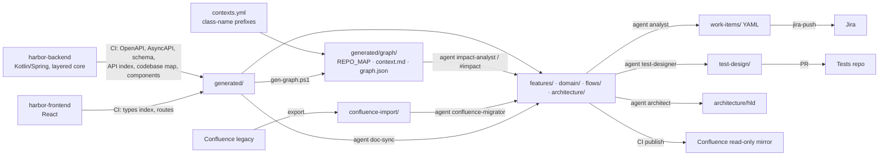

# Harbor — Documentation (`harbor-docs`)

Single source of truth for functional and technical documentation of the **Harbor** platform: account
representatives meet clients to review product movements, model projections, offer cover and run market
scenarios and stress tests. Confluence is a publish target; the code repositories (`harbor-backend`,
`harbor-frontend`) are inputs; Jira and the tests repository are outputs.

The repository is an **Open Knowledge Format v0.2 bundle**: every doc is a concept with YAML frontmatter
(`type`, `description`, trust/lifecycle fields); `index.md` per folder gives agents progressive disclosure.



## Quick start (Copilot in IDE / CLI)
- Open this repo (optionally add `harbor-backend` / `harbor-frontend` as extra workspace folders, read-only).
- Agents always start at `index.md` → folder `index.md` → concept (see `.github/skills/okf/SKILL.md`).
- `scripts/context-pack.ps1 -Task <ID>` — assemble a **task-scoped context** for an analyst: the spec, its
  calculations, glossary terms, graph neighbourhood and contract anchors for one feature ID (e.g. `P1-001`).
- `@doc-sync` / `/spec-from-code featureId=P1-001` — create or refresh a spec from `generated/`.
- `@analyst` / `/jira-from-spec` — stories & subtasks → `work-items/`.
- `@test-designer` / `/tests-from-spec` — Gherkin + fixtures → `test-design/`.
- `@architect` / `/hld-from-spec` — HLD.
- `@impact-analyst` / `/impact-from-graph` — blast radius from `generated/graph/` (no source reading);
  `/spec-skeleton-from-graph` — spec skeleton prefilled from a context neighbourhood (skill `code-graph`).
  CLI: `scripts/graph-query.ps1 -Node spec:P1-001 -Depth 2` or `-Files (git diff --name-only)`.
- `@confluence-migrator confluence-import/HARBOR/<page>.md` — migrate a legacy page.
- `@migration-lead` / `/migration-plan all` — which lifecycle runs (skeleton, legacy merge, calculation audit, owner
  decision) are still due per context, with the command for each → `migration/<scope>.md`
  (skill `spec-lifecycle`, script `scripts/migration-status.ps1`).
- `/okf-validate`, `/okf-produce` — OKF conformance and knowledge capture
  (skills `okf`, `okf-validate`, `okf-visualize`).

Everything an agent needs is in `.github/` (instructions, agents, prompts, skills) — no MCP, no external frameworks.

## Layout
See `.github/copilot-instructions.md` (table), `index.md` (generated) and per-folder `index.md`.
Bounded contexts and spec ID prefixes: [features/conventions.md](features/conventions.md);
domain vocabulary: [domain/glossary.md](domain/glossary.md); contexts: [domain/context-map.md](domain/context-map.md).
The backend is layered (package-by-layer, ADR-0004): a bounded context is a set of class-name prefixes in
`contexts.yml`, used by `gen-graph.ps1`, `context-pack.ps1` and the globs in `docs-map.yml`; the BE map
`generated/be/components.md` lists every class with its layer, injected dependencies and tables.

## Local checks
```powershell
./scripts/okf-validate.ps1 -Strict          # OKF §11 conformance + warnings (no Python needed)
./scripts/build-index.ps1                   # regenerate index.md files (-Check in CI)
./scripts/validate-frontmatter.ps1          # repo-specific keys (IDs, BR numbering, links)
git -C ../harbor-backend diff --name-only main | % { "be/$_" } | ./scripts/map-paths.ps1
```
