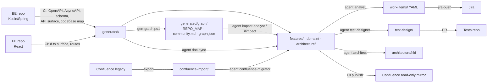

# Advisory Platform — Documentation (prototype skeleton)

Single source of truth for functional & technical documentation of the Financial Advisory Platform.
Confluence is a publish target; FE/BE repos are inputs; Jira and the tests repo are outputs.
The repository is an **Open Knowledge Format v0.2 bundle**: every doc is a concept with YAML frontmatter
(`type`, `description`, trust/lifecycle fields); `index.md` per folder gives agents progressive disclosure.



## Quick start (Copilot in IDE / CLI)
- Open this repo (optionally add FE/BE as extra workspace folders, read-only).
- Agents always start at `index.md` → folder `index.md` → concept (see `.github/skills/okf/SKILL.md`).
- `@doc-sync` / `/spec-from-code featureId=HEDGE-012` — create or refresh a spec.
- `@analyst` / `/jira-from-spec` — stories & subtasks → `work-items/`.
- `@test-designer` / `/tests-from-spec` — Gherkin + fixtures → `test-design/`.
- `@architect` / `/hld-from-spec` — HLD.
- `@impact-analyst` / `/impact-from-graph` — blast radius from `generated/graph/` (no source reading);
  `/spec-skeleton-from-graph` — spec skeleton prefilled from a module/feature neighbourhood (skill `code-graph`).
  CLI: `scripts/graph-query.ps1 -Node spec:HEDGE-001 -Depth 2` or `-Files (git diff --name-only)`.
- `@confluence-migrator confluence-import/SPACE/page.md` — migrate a legacy page.
- `/okf-validate`, `/okf-produce` — OKF conformance and knowledge capture (skills `okf`, `okf-validate`, `okf-visualize`).

Everything an agent needs is in `.github/` (instructions, agents, prompts, skills) — no MCP, no external frameworks.

## Layout
See `.github/copilot-instructions.md` (table), `index.md` (generated) and per-folder `index.md`.

## Local checks
```powershell
./scripts/okf-validate.ps1 -Strict          # OKF §11 conformance + warnings (no Python needed)
./scripts/build-index.ps1                   # regenerate index.md files (-Check in CI)
./scripts/validate-frontmatter.ps1          # repo-specific keys (IDs, BR numbering, links)
git -C ../be diff --name-only main | % { "be/$_" } | ./scripts/map-paths.ps1
```
