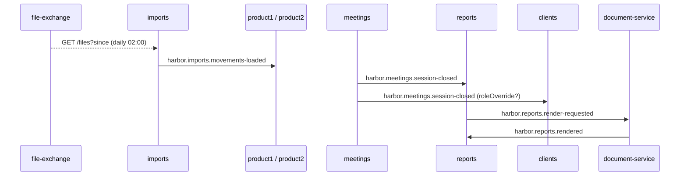

# Integrations map

Rows marked `gen` are refreshed by CI from `generated/asyncapi/backend.yaml` and `generated/openapi/`;
rows marked `manual` are maintained by hand. Topic names are constants in `Topics.kt`[^topics] (library `kafka_client`,
payload classes in `harbor.kafka.events`); producers and consumers live in the `event/` layer of `core`. Producers call
`kafkaTemplate.send(Topics.X, key, payload)`, consumers use
`@KafkaListener(topics = [Topics.X], groupId = "harbor-<context>")`.

## Kafka topics

| Constant | Topic | Producer | Consumers | Payload | Contract | Feature | Src |
|---|---|---|---|---|---|---|---|
| `MOVEMENTS_LOADED` | `harbor.imports.movements-loaded` | `event/MovementsLoadedPublisher` | `event/Product1ProjectionRefreshListener`, `event/Product2ProjectionRefreshListener` | `MovementsLoadedEvent(batchId, clientIds, periodFrom, periodTo)` | `generated/asyncapi/backend.yaml#/channels/harbor.imports.movements-loaded` | IMP-001, P1-001, P2-001 | gen |
| `PRICES_UPDATED` | `harbor.market.prices-updated` | external (`market-data`) | `event/MarketPricesListener` | `PricesUpdatedEvent(productGroup, corridor, asOf)` | `generated/asyncapi/backend.yaml#/channels/harbor.market.prices-updated` | MKT-001 | gen |
| `SESSION_CLOSED` | `harbor.meetings.session-closed` | `event/SessionEventsPublisher` | `event/ReportSessionClosedListener`, `event/ClientRoleSessionClosedListener` | `SessionClosedEvent(sessionId, clientId, productGroup, kind, roleOverride?)` | `generated/asyncapi/backend.yaml#/channels/harbor.meetings.session-closed` | SES-001, RPT-001, CLI-001 | gen |
| `REPORT_RENDER_REQUESTED` | `harbor.reports.render-requested` | `event/ReportRenderRequester` | external (`document-service`) | `ReportRenderRequested(sessionId, payloadRef)` | `generated/asyncapi/backend.yaml#/channels/harbor.reports.render-requested` | RPT-001 | gen |
| `REPORT_RENDERED` | `harbor.reports.rendered` | external (`document-service`) | `event/ReportRenderedListener` | `ReportRendered(sessionId, pdfPath)` | `generated/asyncapi/backend.yaml#/channels/harbor.reports.rendered` | RPT-001 | gen |

Event flow (happy path of one meeting):

## REST (outbound, external services)

Client wrappers live in the `client/` layer of `core` (`core/src/main/kotlin/harbor/client/<Name>Client.kt`, a thin
`@Component` wrapping the generated `*Api`). Contracts: `backend/core/src/main/resources/api/<name>.yaml`, published as
`generated/openapi/external/<name>.yaml`.

| System | Client | Endpoints | Purpose | Contract | Feature | Src |
|---|---|---|---|---|---|---|
| `client-registry` | `client/ClientRegistryClient` | `GET /registry/clients?q`, `GET /registry/clients/{ref}` | client search and master data merged into `client_profile` | `generated/openapi/external/client-registry.yaml` | CLI-001 | gen |
| `market-data` | `client/MarketDataClient` | `GET /prices/{productGroup}/{corridor}?from&to`, `GET /transport-prices/{productGroup}/{corridor}` | baseline price and transport price curves into `baseline_price` | `generated/openapi/external/market-data.yaml` | MKT-001 | gen |
| `cover-provider` | `client/CoverProviderClient` | `POST /quotes` | quote for the uncovered value of a session | `generated/openapi/external/cover-provider.yaml` | COV-001 | gen |
| `document-service` | `client/DocumentServiceClient` | `POST /render`, `GET /documents/{id}` | PDF rendering and retrieval of the meeting report | `generated/openapi/external/document-service.yaml` | RPT-001 | gen |
| `file-exchange` | `client/FileExchangeClient` | `GET /files?since`, `GET /files/{id}/content` | daily XLS movement files | `generated/openapi/external/file-exchange.yaml` | IMP-001 | gen |

Auth and resilience (manual): all outbound calls use mTLS plus a service token; retries 3× with exponential
back-off on 5xx; `market-data` and `client-registry` responses are cached per corridor / per query for 10 minutes.

## REST (inbound, own API)

`generated/openapi/backend.yaml`[^openapi], server base `/api/v1`, tags = bounded contexts. Every `/session/**`
path requires header `X-Harbor-Session` (`component/SessionHeaderFilter`, see [SES-001](/features/meetings/SES-001.md)).

| Context (tag) | operationIds |
|---|---|
| clients | `searchClients`, `getClient`, `getClientOverview`, `getClientRole` |
| meetings | `createSession`, `listSessions`, `getSession`, `closeSession`, `setRoleOverride` |
| product1 | `getProduct1Overview`, `putProduct1Movements`, `postProduct1PeerSimulation`, `getProduct1Projection` |
| product2 | `getProduct2Overview`, `putProduct2Movements`, `postProduct2PeerSimulation`, `getProduct2Projection` |
| cover | `getCoverSummary`, `requestCoverQuote`, `listCoverPolicies` |
| market | `listScenarios`, `createScenario`, `updateScenario`, `deleteScenario`, `getBaselinePrices` |
| stress | `runStressTest`, `getStressTest` |
| reports | `getReport`, `downloadReportPdf`, `regenerateReport` |
| admin | `listParameters`, `upsertParameter`, `listImportBatches`, `triggerImport` |

## Scheduled jobs (manual)

| Job (`job/`) | Cron | Context | Effect |
|---|---|---|---|
| `DailyMovementImportJob` | `0 0 2 * * *` | imports | pulls new files from `file-exchange`, parses into `goods_movement`, emits `movements-loaded` |
| `MonthlySnapshotJob` | `0 0 3 1 * *` | imports | rolls `goods_movement` up into `movement_monthly` |

[^topics]: `Topics.kt` (`object Topics { const val ... }`, harbor-backend `kafka_client` module)
[^openapi]: `generated/openapi/backend.yaml` (copy of `backend/core/src/main/resources/openapi/harbor-api.yaml`)
