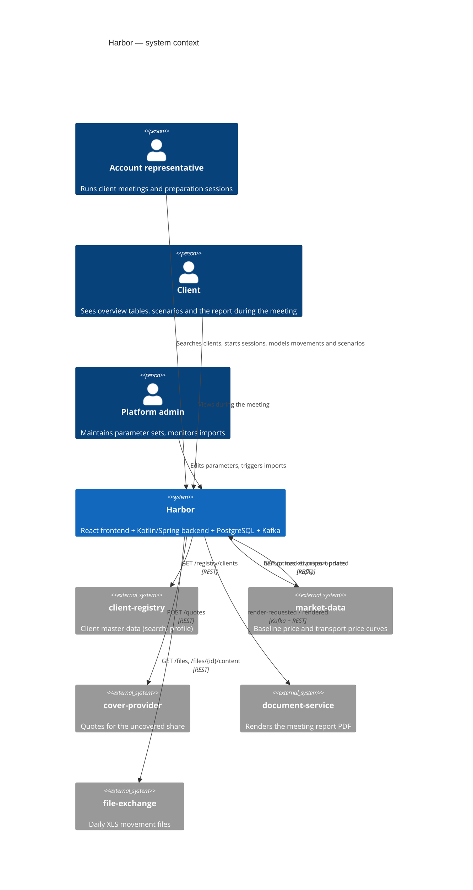
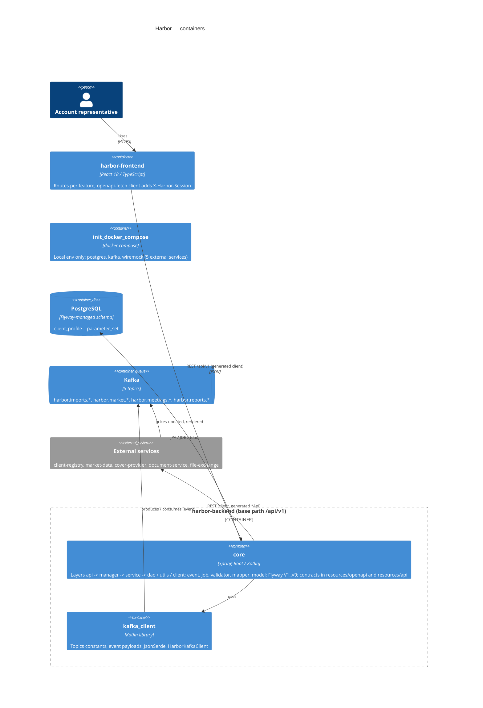

# Architecture

arc42-lite structure. Diagrams are Mermaid (renders in GitHub/GitLab/IDE; no binary files).

| File | Content |
|---|---|
| this page | C4 level 1 (context) and level 2 (containers) |
| `03-components.md` | C4 level 3 per bounded context (generated skeleton from `generated/be/components.md`) |
| `04-runtime.md` | key sequences: start meeting, projection refresh, stress test run, report rendering |
| `05-deployment.md` | environments, topology |
| [integrations.md](/architecture/integrations.md) | REST and Kafka integrations with contract anchors |
| `hld/<ID>.md` | high-level designs per feature/epic (agent `architect`) |
| `adr/` | Architecture Decision Records: [ADR-0001](/architecture/adr/0001-docs-as-code.md), [ADR-0002](/architecture/adr/0002-openapi-first-contracts.md), [ADR-0003](/architecture/adr/0003-grouping-in-kotlin-not-sql.md), [ADR-0004](/architecture/adr/0004-layered-backend-and-context-prefixes.md) |

Repositories: `harbor-backend` (Kotlin 1.9 / Spring Boot 3 / Maven `core` + `kafka_client` / PostgreSQL with Flyway / Kafka),
`harbor-frontend` (React 18 / TypeScript / react-router / openapi-fetch), `harbor-docs` (this bundle).
Remotes: `https://git.example.com/harbor/<repo>`.

## C4 level 1 — context

## C4 level 2 — containers

The backend is one Spring Boot application, Maven module `core`, organised **by technical layer**
(`core/src/main/kotlin/harbor/<layer>/`). Kafka topic constants, event payloads and the serde live in the library
module `kafka_client`, used by `core`. Bounded contexts of the [context map](/domain/context-map.md) are not folders:
a class belongs to a context by its **name prefix** (`/contexts.yml`, see [ADR-0004](/architecture/adr/0004-layered-backend-and-context-prefixes.md)).
Only `core` is deployed; `init_docker_compose/` starts PostgreSQL, Kafka and WireMock stubs of the external services for local runs.

### Layers of `core`

| Layer | Role | Examples |
|---|---|---|
| `api` | REST controllers implementing the generated `*Api` interfaces | `Product1Controller`, `SessionController` |
| `manager` | one per context: orchestration, transaction boundary, KDoc + `@docs <ID>` | `Product1Manager` (P1-001), `MeetingManager` (SES-001) |
| `service` | business services used by managers | `ProjectionService`, `StressTestService` |
| `dao` | repositories (tables per class in `generated/be/components.md`) | `ProjectionDao`, `MeetingSessionDao` |
| `utils` | pure Kotlin calculations (`@docs <calculation>`) | `ProjectionAggregator`, `StressTestCalculator` |
| `event` / `job` | Kafka listeners and publishers / `@Scheduled` jobs | `SessionEventsPublisher`, `DailyMovementImportJob` |
| `client` | wrappers over generated clients of the external services | `ClientRegistryClient`, `MarketDataClient` |
| `validator`, `mapper`, `model`, `component`, `context`, `config`, `advice`, ... | validation, DTO mapping, entities, filters, session context, configuration, error handling | `SessionHeaderFilter`, `SessionContext` |

### Contexts at a glance

| Context (BE prefixes) | Entry point (`@docs`) | Owns tables | Produces / consumes |
|---|---|---|---|
| `clients` (`Client*`) | `ClientManager.kt` (CLI-001) | `client_profile`, `client_role` | consumes `harbor.meetings.session-closed` |
| `meetings` (`Session*`, `Meeting*`) | `MeetingManager.kt` (SES-001) | `meeting_session`, `session_client_config` | produces `harbor.meetings.session-closed` |
| `imports` (`Import*`, `Movement*`, ...) | `ImportManager.kt` (IMP-001) | `import_batch`, `goods_movement`, `movement_monthly` | produces `harbor.imports.movements-loaded` |
| `product1` / `product2` (`Product1*`, `Projection*`, `Peer*` / `Product2*`) | `Product1Manager.kt` (P1-001) / `Product2Manager.kt` (P2-001) | `session_movement_input`, `session_peer_simulation`, `projection_*` | consume `harbor.imports.movements-loaded` |
| `cover` (`Cover*`) | `CoverManager.kt` (COV-001) | `cover_policy`, `cover_quote` | — |
| `market` (`Market*`, `Scenario*`, `BaselinePrice*`) | `MarketManager.kt` (MKT-001) | `market_scenario`, `baseline_price` | consumes `harbor.market.prices-updated` |
| `stress` (`Stress*`) | `StressManager.kt` (STR-001) | `stress_test_result` | — |
| `reports` (`Report*`) | `ReportManager.kt` (RPT-001) | `meeting_report` | consumes `session-closed`, `rendered`; produces `render-requested` |
| `admin` (`Admin*`, `Parameter*`) | `AdminManager.kt` (ADM-001) | `parameter_set` | — |
| `shared` (no prefix) | — | — | config, filters, `utils` helpers (`MonthGrid`, `Rounding`); `kafka_client` |

## Cross-cutting rules
- **OpenAPI-first** ([ADR-0002](/architecture/adr/0002-openapi-first-contracts.md)): `backend/core/src/main/resources/openapi/harbor-api.yaml`
  is the contract; controllers implement generated `*Api` interfaces; the frontend uses the generated client.
- **Session scoping**: selecting a product group on the client overview creates a `meeting_session`; every
  `/session/**` request carries `X-Harbor-Session` (see [SES-001](/features/meetings/SES-001.md)).
- **Grouping in Kotlin, not SQL** ([ADR-0003](/architecture/adr/0003-grouping-in-kotlin-not-sql.md)): the four
  projection tables are aggregated by `utils/ProjectionAggregator.kt` and reused by cover, stress and reports.
- **Calculations** are pure Kotlin in `core/src/main/kotlin/harbor/utils/`, each attested in `domain/calculations/` with
  worked examples copied from its unit test.
- **Layers and prefixes** ([ADR-0004](/architecture/adr/0004-layered-backend-and-context-prefixes.md)): `api` -> `manager`
  -> `service` -> `dao` / `utils` / `client`; the class-name prefix decides the context.
