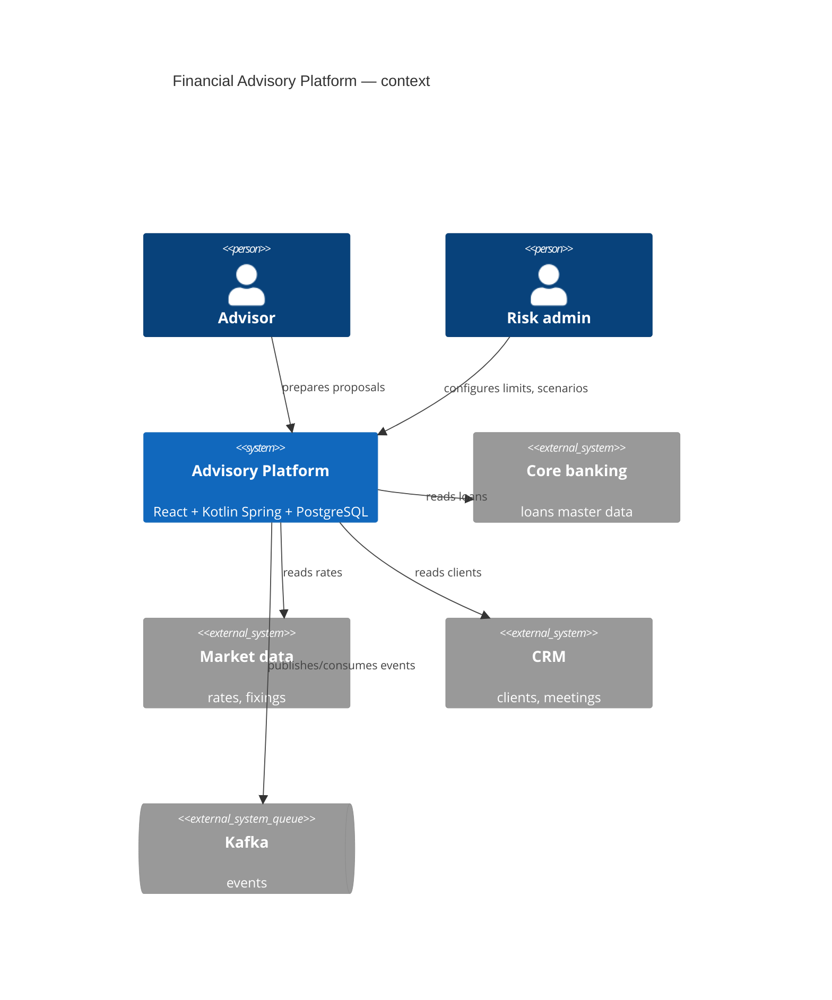

# Architecture

arc42-lite structure. Diagrams are Mermaid (renders in GitHub/GitLab/IDE; no binary files).

| File | Content |
|---|---|
| `01-context.md` | C4 level 1: system, users, external systems |
| `02-containers.md` | C4 level 2: FE, BE, PostgreSQL, Kafka, external services |
| `03-components.md` | C4 level 3 per bounded context (generated skeleton from `codebase-map.md`) |
| `04-runtime.md` | key sequences: proposal creation, monthly run, stress test |
| `05-deployment.md` | environments, topology |
| [integrations.md](/architecture/integrations.md) | table of REST/Kafka integrations (partly generated from AsyncAPI/OpenAPI) |
| `hld/<ID>.md` | high-level designs per feature/epic (agent `architect`) |
| `adr/` | Architecture Decision Records, e.g. [ADR-0001](/architecture/adr/0001-docs-as-code.md) |

## C4 Context (example)

