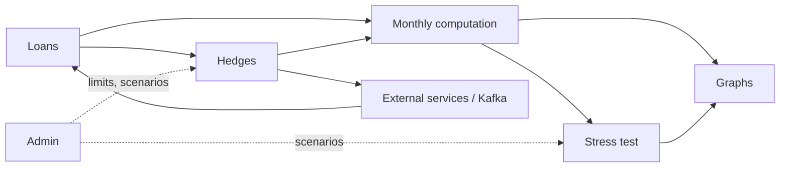

# Domain context map

- [Glossary](/domain/glossary.md) — canonical terminology.
- `calculations/` — one [Attested Computation](/.github/skills/okf/reference/SPEC.md) per financial calculation:
  formula + conventions + worked examples. Skill: `.github/skills/calculation-spec/SKILL.md`.

