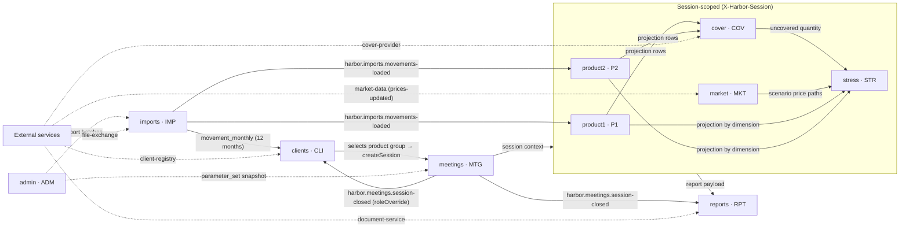

# Domain context map

- [Glossary](/domain/glossary.md) — canonical terminology.
- `calculations/` — one **Attested Computation** per calculation in the backend `utils` layer
  (`core/src/main/kotlin/harbor/utils/`): formula + conventions + worked examples copied from the unit test.
  Skill: `.github/skills/calculation-spec/SKILL.md`.
- The backend is layered ([ADR-0004](/architecture/adr/0004-layered-backend-and-context-prefixes.md)), so a bounded
  context is a **group of class-name prefixes** (`/contexts.yml`, longest prefix wins) = one frontend feature
  (`src/features/<context>`) = one spec folder (`features/<context>/`). Its entry point is `manager/<Ctx>Manager.kt`.

## Bounded contexts and ID prefixes

| Context | Spec prefix | BE class-name prefixes | Backend entry point | FE feature / routes | Specs |
|---|---|---|---|---|---|
| clients | `CLI` | `Client` | `manager/ClientManager.kt` | `clients`: `/clients`, `/clients/:clientId` | [CLI-001](/features/clients/CLI-001.md) |
| meetings | `MTG` | `Session`, `Meeting`, `RoleOverride`, `SessionClientConfig` | `manager/MeetingManager.kt` | `meetings`: `/meetings`, `/session/:sessionId/summary` | [MTG-001](/features/meetings/MTG-001.md) |
| imports | `IMP` | `Import`, `Movement`, `Movements`, `GoodsMovement`, `Xls`, `Workbook`, `DailyMovement`, `MonthlySnapshot` | `manager/ImportManager.kt` | — (jobs; monitored via admin) | missing (`IMP-001` backlog) |
| product1 | `P1` | `Product1`, `Projection`, `Peer`, `MovementInput`, `SessionMovementInput`, `SessionPeerSimulation` | `manager/Product1Manager.kt` | `product1`: `/session/:sessionId/product1` | [P1-001](/features/product1/P1-001.md) |
| product2 | `P2` | `Product2` | `manager/Product2Manager.kt` | `product2`: `/session/:sessionId/product2` | missing (`P2-001` backlog) |
| cover | `COV` | `Cover` | `manager/CoverManager.kt` | `cover`: widgets inside product pages | missing (`COV-001` backlog) |
| market | `MKT` | `Market`, `Scenario`, `BaselinePrice` | `manager/MarketManager.kt` | `market`: `/session/:sessionId/scenarios` | [MKT-001](/features/market/MKT-001.md) (skeleton) |
| stress | `STR` | `Stress` | `manager/StressManager.kt` | `stress`: `/session/:sessionId/stress-test` | [STR-001](/features/stress/STR-001.md) (draft) |
| reports | `RPT` | `Report` | `manager/ReportManager.kt` | `reports`: Download PDF on the Meetings page | [RPT-001](/features/reports/RPT-001.md) (skeleton) |
| admin | `ADM` | `Admin`, `Parameter` | `manager/AdminManager.kt` | `admin`: `/admin/parameters`, `/admin/imports` | [ADM-001](/features/admin/ADM-001.md) (draft) |
| presentation | `PRS` | — (FE-only) | — | `presentation`: `/present/:sessionId` (second window, BroadcastChannel `harbor.session.<id>`) | [PRS-001](/features/presentation/PRS-001.md) (draft), flow [client-presentation](/flows/client-presentation.md) |

Classes matching no prefix are `shared` and are not a bounded context: configuration (`WebConfig`, `KafkaConfig`, ...),
`enums`, the `utils` helpers (`MonthGrid`, `Rounding`), unprefixed `client/` wrappers (`DocumentServiceClient`,
`FileExchangeClient`) and the `kafka_client` library (`Topics`, event payloads). They have no spec prefix and are documented in
`domain/calculations/` and [architecture/integrations.md](/architecture/integrations.md).

## Relationships

### Relationship notes
- **clients → meetings** (customer/supplier): the overview page's "Start meeting" / "Prepare" buttons call
  `createSession`; from then on the session id travels in the header.
- **meetings → clients** (published language, Kafka): `SessionClosedEvent.roleOverride` lets `ClientRoleSessionClosedListener`
  update `client_role` with `source = MANUAL`.
- **imports → product1/product2** (published language, Kafka): a loaded batch triggers a projection refresh for
  open sessions of the affected clients.
- **product1/product2 → cover, stress, reports** (shared kernel): all read the same four `projection_*` tables
  ([ADR-0003](/architecture/adr/0003-grouping-in-kotlin-not-sql.md)).
- **market → stress** (conformist): the stress test takes scenario price paths as given.
- **admin** is outside meetings; a session copies the parameters it needs into `parameter_snapshot` so a
  parameter change never alters an open session.
