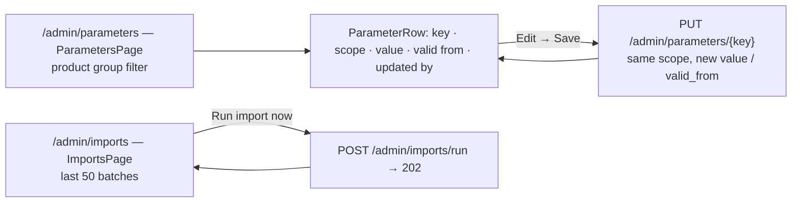

# ADM-001 — Parameter sets and import monitor

## Summary
The admin area sits outside meetings. On `/admin/parameters` an administrator sees every value of
`parameter_set`, filtered by product group, and edits a value or its `valid_from` inline; a change creates a new
version of the key for that scope or updates the version that already starts on that date. The keys themselves are
fixed in code (`ParameterKey`); the page cannot invent one. On `/admin/imports` the administrator sees the last
batches of the daily XLS movement import and can start a run now.[^manager]

This spec owns the **mechanism**: which keys exist, how a value is scoped, versioned, validated and read. The
**meaning** of a key (unit, formula it feeds, business rule that bounds it) is owned by the calculation that reads it;
see [Parameters](#parameters) for the map from key to owner.

## Actors
| Actor | Role in this feature |
|---|---|
| Administrator | Edits parameter values, triggers an import |
| Calculations and services | Read values through `ParameterService` (never the table directly) |
| meetings context | Copies the values in force into `meeting_session.parameter_snapshot` at session creation ([MTG-001](/features/meetings/MTG-001.md) BR-2) |
| imports context | Owns the import itself; this spec only monitors and triggers it (`IMP-001`, backlog) |

## Business rules
- **BR-ADM-001-1** — `listParameters` MUST return all `parameter_set` rows ordered by key, scope and `valid_from`
  descending; with `productGroup` set it MUST return the rows of that product group plus the global rows
  (`scope_product_group IS NULL`).[^service]
- **BR-ADM-001-2** — `upsertParameter` MUST reject a key that is not a `ParameterKey` constant with `400`
  ("Unknown parameter key"); the set of keys is defined in code, not on the page.[^validator]
- **BR-ADM-001-3** — `upsertParameter` MUST validate the value per key: `role.importer_threshold`,
  `role.exporter_threshold`, `tariff.rate`, `cover.default_premium_rate` in `0..1`;
  `projection.horizon_months_default` a whole number in `12..60`; `stress.rounding_scale` a whole number in `0..6`;
  `role.min_volume`, `handling.cost`, `transport.cost`, `peer.scaling_default` not negative. Violations return `400`.[^validator]
- **BR-ADM-001-4** — A value is identified by `(key, scope_product_group, scope_country, scope_value, valid_from)`.
  `upsertParameter` MUST update `value`, `updated_by`, `updated_at` of an existing row with that identity and MUST
  insert a new row otherwise; `valid_from` defaults to today and `scope_country` is stored upper-case.[^service]
- **BR-ADM-001-5** — `updated_by` MUST be the authenticated user; the request body carries no author.[^manager]
- **BR-ADM-001-6** — A lookup (`find`, `required`) MUST consider only rows with `valid_from <= today` and MUST choose
  the most specific matching scope (product group + country + scope value > product group + country > product
  group > global); among equal specificity the newest `valid_from` wins.[^service]
- **BR-ADM-001-7** — `required` MUST fail with `500` when no value is in force for the key and scope (configuration
  error, not a user error); callers that have a request-level override use it first (`scalingFactor`,
  `horizonMonths`).[^service]
- **BR-ADM-001-8** — `byScopeValue` MUST return one value per `scope_value` (city, transport mode) in force today,
  restricted to rows that are global or belong to the requested product group.[^service]
- **BR-ADM-001-9** — Values are read per call; there is no cache. A change is visible to the next calculation that
  runs outside a session, and MUST NOT change an open session, which works on its snapshot (MTG-001 BR-2).[^service]
- **BR-ADM-001-10** — `listImportBatches` MUST return the 50 newest `import_batch` rows by `received_at`.[^manager]
- **BR-ADM-001-11** — `triggerImport` MUST run the movement import with trigger `MANUAL` and return `202` with the
  first batch created, or a transient `DONE` batch with `source_file = "(no new files)"` when nothing was new. The
  page MUST disable the trigger while a batch is `RUNNING`.[^manager]

## UI flow

Hooks: `useParameters`, `useUpsertParameter`, `useImportBatches`, `useTriggerImport` (`fe/src/features/admin/api/`).
The pages are not session-scoped: no `X-Harbor-Session` header.

## API / Events
| Kind | Name | Purpose | Contract |
|---|---|---|---|
| REST | `GET /admin/parameters?productGroup=` | `listParameters` — all values, optional product-group filter (BR-1) | `generated/openapi/backend.yaml#/paths/~1admin~1parameters` |
| REST | `PUT /admin/parameters/{key}` | `upsertParameter` — new version or update of a scoped value (BR-2..5) | `generated/openapi/backend.yaml#/paths/~1admin~1parameters~1{key}` |
| REST | `GET /admin/imports` | `listImportBatches` — monitor (BR-10) | `generated/openapi/backend.yaml#/paths/~1admin~1imports` |
| REST | `POST /admin/imports/run` | `triggerImport` — manual run (BR-11) | `generated/openapi/backend.yaml#/paths/~1admin~1imports~1run` |

## Data
| Table | Use |
|---|---|
| `parameter_set` | `key`, `scope_product_group`, `scope_country`, `scope_value`, `value numeric(18,6)`, `valid_from`, `updated_by`, `updated_at`; unique on the identity of BR-4 (`V9__parameters.sql`) |
| `import_batch` | read: `source_file`, `received_at`, `rows_total`, `rows_rejected`, `status` (`RUNNING|DONE|FAILED`) (BR-10) |

## Parameters
Keys, seeded defaults, readers and the validator are generated: [`generated/be/parameters.md`](/generated/be/parameters.md).
This table maps each key to the document that owns its meaning; `validate-frontmatter.py` checks that every key of
the catalogue is named by a calculation or a feature spec and that no document names a key the catalogue lacks.

| Key | Meaning | Owner of the meaning |
|---|---|---|
| `role.min_volume` | minimum 12-month volume below which a client role is `UNDETERMINED` | [client_role_classification](/domain/calculations/client_role_classification.md) |
| `role.importer_threshold` | inbound share at or above which the role is `IMPORTER` | [client_role_classification](/domain/calculations/client_role_classification.md) |
| `role.exporter_threshold` | inbound share at or below which the role is `EXPORTER` | [client_role_classification](/domain/calculations/client_role_classification.md) |
| `tariff.rate` | tariff share of value per product group and price-basis country | [monthly_projection](/domain/calculations/monthly_projection.md) |
| `handling.cost` | handling cost per unit per city hub | [monthly_projection](/domain/calculations/monthly_projection.md) |
| `transport.cost` | transport cost per unit per transport mode | [monthly_projection](/domain/calculations/monthly_projection.md) |
| `cover.default_premium_rate` | premium rate of a cover quote when the policy has none | [cover_ratio](/domain/calculations/cover_ratio.md) (quotes) |
| `projection.horizon_months_default` | horizon of a new session in months | [MTG-001](/features/meetings/MTG-001.md) BR-3 |
| `stress.rounding_scale` | scale of the stress-test money amounts | [stress_test_monthly](/domain/calculations/stress_test_monthly.md) |
| `peer.scaling_default` | scaling factor of the peer benchmark when the request gives none | [peer_benchmark_simulation](/domain/calculations/peer_benchmark_simulation.md) |

## Calculations
None of its own. Every calculation that reads a parameter lists the key in its `## Parameters` section; the reverse
map is the table above.

## Edge cases
- Editing a row and keeping `valid_from` updates that version in place; moving `valid_from` forward creates a new
  version and leaves the old one as history (BR-4).
- A value with a future `valid_from` is listed on the page but not in force (BR-6).
- Deleting a value is not supported; no endpoint exists. ❓ UNVERIFIED whether this is a product decision.
- A scoped value more specific than the request (for example `tariff.rate` with a country when the caller asks for
  the product group only) is not matched; the global or product-group row is used (BR-6).

## Open questions
- [ ] Who is allowed to edit parameters? The code only records `updated_by`; no role check was found. ❓ UNVERIFIED
- [ ] Should an edit of a key that an open session has snapshotted warn the administrator (BR-9)?
- [ ] Deletion or end-dating of a value (no `valid_to` column today).
- [ ] `cover.default_premium_rate` is listed by `cover_ratio` but read by the quote service; the quote calculation has
  no document yet.

## Change log
| Date | Change | Ref |
|---|---|---|
| 2026-10-13 | Run 1 skeleton from the admin graph and the manager, service and validator files; parameter map added | — |

[^manager]: AdminManager.kt (harbor-backend, `core`, layer `manager`)
[^service]: ParameterService.kt, ParameterDao.kt (harbor-backend, `core`, layers `service`, `dao`)
[^validator]: ParameterValidator.kt (harbor-backend, `core`, layer `validator`)
