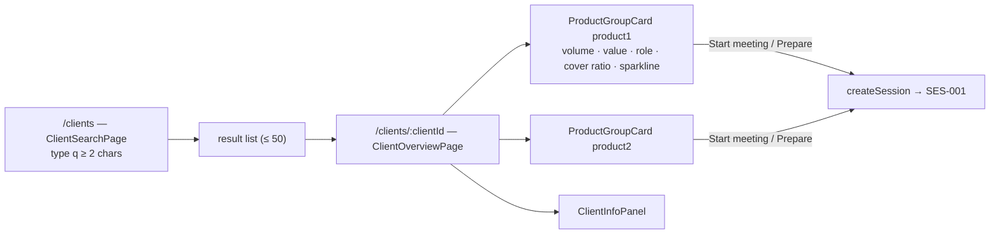

# CLI-001 — Client search, overview and role classification

## Summary
A representative finds a client by name or external reference, opens the **client overview** and sees one card
per product group (last-12-month volume and value, role, cover ratio, open sessions, sparkline) plus the client
info panel. From a card the representative starts a meeting or a preparation session (see
[SES-001](/features/meetings/SES-001.md)). The client **role** (importer / exporter / mixed) is computed by
[client_role_classification](/domain/calculations/client_role_classification.md) and can be replaced by a manual
override decided in a closed client meeting.

## Actors
| Actor | Role in this feature |
|---|---|
| Representative | Searches clients, reads the overview, starts sessions |
| Client (read-only, during meeting) | Sees the overview cards |
| client-registry (external) | Source of client master data |
| meetings context | Publishes `session-closed` with an optional role override |

## Business rules
- **BR-CLI-001-1** — `searchClients` MUST forward `q` to `client-registry` (`GET /registry/clients?q`) and merge
  each hit with the local `client_profile` matched by `external_ref`, creating a profile row on first sight.[^manager]
- **BR-CLI-001-2** — `searchClients` MUST reject a query shorter than 2 characters with `400` and MUST return at
  most 50 hits ordered by name.[^manager]
- **BR-CLI-001-3** — `getClientOverview` MUST return, for each of the two product groups, the last-12-full-month
  totals of `movement_monthly.quantity` and `value`, the effective role, the current cover ratio, the count of
  `meeting_session` rows with `status = OPEN` and a 12-point sparkline of monthly value.[^manager]
- **BR-CLI-001-4** — The algorithmic role MUST be computed with `client_role_classification` over the last 12 full
  months using the thresholds of the current `parameter_set` (`role.min_volume`, `role.importer_threshold`,
  `role.exporter_threshold`).[^manager]
- **BR-CLI-001-5** — When a `client_role` row with `source = MANUAL` exists for the product group, it MUST be the
  effective role; the algorithmic result is still returned by `getClientRole` as `algorithm`.[^manager]
- **BR-CLI-001-6** — On `harbor.meetings.session-closed` with `kind = CLIENT` and a non-null `roleOverride`, the
  listener MUST upsert `client_role(source = MANUAL, reason, decided_at = closed_at)` for
  `(clientId, productGroup)`.[^listener]
- **BR-CLI-001-7** — A `session-closed` event with `kind = PREPARATION` MUST NOT change `client_role`, even when
  `roleOverride` is set.[^listener]
- **BR-CLI-001-8** — `getClientRole` MUST return the algorithmic result (role + share) and the manual history
  ordered by `decided_at` descending.[^manager]
- **BR-CLI-001-9** — `getClient` and `getClientOverview` MUST return `404` for an unknown `clientId` and MUST NOT
  call `client-registry` for it.[^manager]

## UI flow

Hooks: `useClientSearch`, `useClientOverview`, `useClientRole` (`fe/src/pages/ClientOverviewPage/hook/`).[^legacy-flow]

## API / Events
| Kind | Name | Purpose | Contract |
|---|---|---|---|
| REST | `GET /clients?q=` | `searchClients` — registry proxy + local merge | `generated/openapi/backend.yaml#/paths/~1clients` |
| REST | `GET /clients/{clientId}` | `getClient` — profile | `generated/openapi/backend.yaml#/paths/~1clients~1{clientId}` |
| REST | `GET /clients/{clientId}/overview` | `getClientOverview` — cards per product group | `generated/openapi/backend.yaml#/paths/~1clients~1{clientId}~1overview` |
| REST | `GET /clients/{clientId}/role?productGroup=` | `getClientRole` — algorithm + manual history | `generated/openapi/backend.yaml#/paths/~1clients~1{clientId}~1role` |
| REST (out) | `GET /registry/clients?q`, `GET /registry/clients/{ref}` | client-registry | `generated/openapi/external/client-registry.yaml` |
| Kafka (in) | `harbor.meetings.session-closed` | apply role override | `generated/asyncapi/backend.yaml#/channels/harbor.meetings.session-closed` |

## Data
| Table | Use |
|---|---|
| `client_profile` | `id`, `external_ref`, `name`, `country`, `segment`, `created_at` — written on first search hit (BR-1) |
| `client_role` | `client_id`, `product_group`, `role`, `source` (`ALGORITHM|MANUAL`), `reason`, `decided_at` — manual rows via BR-6 |
| `movement_monthly` | read: last-12-month sums per product group and direction (BR-3, BR-4) |
| `meeting_session` | read: open session count (BR-3) |
| `cover_policy` | read: current cover ratio on the card (BR-3) |

## Calculations
- [client_role_classification](/domain/calculations/client_role_classification.md) → BR-CLI-001-4, BR-CLI-001-8
- [cover_ratio](/domain/calculations/cover_ratio.md) → BR-CLI-001-3 (card indicator)

## Edge cases
- Client present in `client-registry` but with no movements → both cards show role `UNDETERMINED`, zero totals.
- `client-registry` unavailable → `searchClients` returns `503`; `getClientOverview` still works from local data.
- Manual override present and later months make the algorithm disagree → manual stays until a new `CLIENT`
  session closes with a different override (BR-5).

## Open questions
- [ ] Should the manual role expire after N months without a new meeting? (Not in code today.)

## Change log
| Date | Change | Ref |
|---|---|---|
| 2026-10-09 | Rebuilt for the Harbor bundle | — |

[^manager]: ClientManager.kt (harbor-backend, `core`, layer `manager`)
[^listener]: ClientRoleSessionClosedListener.kt (harbor-backend, `core`, layer `event`)
[^legacy-flow]: Legacy page HARBOR/Meeting flow (2025-09-02) — screen sequence only; role handling there is outdated
