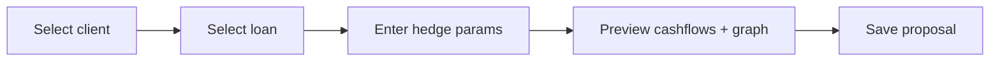

# HEDGE-001 — Propose interest-rate hedge for a loan

> **Example spec** — illustrative content only, to show the expected level of detail (synthetic sources).

## Summary
An advisor, during a client meeting, selects an existing floating-rate loan and creates a hedge proposal
(interest-rate swap) so the client can see fixed vs. floating monthly cashflows and the effect under stress
scenarios.

## Actors
| Actor | Role in this feature |
|---|---|
| Advisor | Creates and edits proposals |
| Client (read-only view) | Sees comparison graph |
| Risk admin | Configures limits used by BR-HEDGE-001-3 |

## Business rules
- **BR-HEDGE-001-1** — A proposal MUST reference exactly one active loan of the client.[^be-service]
- **BR-HEDGE-001-2** — Hedge notional MUST NOT exceed the loan's outstanding principal at the hedge start date.[^be-service]
- **BR-HEDGE-001-3** — Hedge tenor MUST be within the client's approved hedge limit (admin-configured).[^conf-flow]
- **BR-HEDGE-001-4** — Monthly cashflows MUST be computed with [hedge_monthly_cashflow](/domain/calculations/hedge_monthly_cashflow.md) for every month of the tenor.
- **BR-HEDGE-001-5** — On creation the system MUST publish `advisory.hedge.proposal.created`.[^be-service]

## UI flow

## API / Events
| Kind | Name | Purpose | Contract |
|---|---|---|---|
| REST | `POST /hedges/proposals` | create | `generated/openapi/be.yaml` |
| REST | `GET /hedges/proposals/{id}` | read | `generated/openapi/be.yaml` |
| Kafka | `advisory.hedge.proposal.created` | notify downstream | `generated/asyncapi/be.yaml` |

## Data
`hedge_proposal` (1) → `hedge_leg` (n). See `generated/db/schema.md`.

## Calculations
- [hedge_monthly_cashflow](/domain/calculations/hedge_monthly_cashflow.md) → BR-HEDGE-001-4

## Edge cases
- Loan fully repaid before hedge end → proposal rejected (BR-2 at every month, not just start).
- Negative floating rate → see calculation doc, section "Conventions".

## Open questions
- [ ] Is limit check (BR-3) hard block or warning with override?

## Change log
| Date | Change | Ref |
|---|---|---|
| 2026-09-30 | Initial example | — |

[^be-service]: HedgeProposalService.kt (BE, main branch)
[^conf-flow]: Confluence: Hedge proposal flow (legacy page, 2025-11-03)
