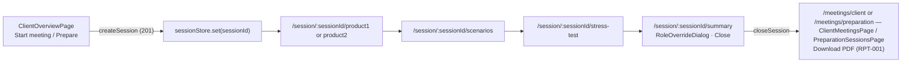

# SES-001 — Meeting session lifecycle and session header

## Summary
A **session** is the unit of work of a meeting. It is created when the representative selects a product group on
the client overview, either as a real meeting (`kind = CLIENT`) or as a dry run (`kind = PREPARATION`). From then on
every request to `/session/**` carries the header `X-Harbor-Session: <sessionId>` and is scoped to that session's
client, product group, horizon and parameter snapshot. Closing the session freezes it, publishes
`harbor.meetings.session-closed` (which triggers the report and the role override) and lists it on the Meetings page.

## Actors
| Actor | Role in this feature |
|---|---|
| Representative | Creates, drives and closes sessions; sets a role override |
| Client | Present in `CLIENT` sessions; never in `PREPARATION` |
| reports, clients contexts | Consume `session-closed` |

## Business rules
- **BR-SES-001-1** — `createSession` MUST insert `meeting_session` with `status = OPEN`, the given `productGroup`
  and `kind` (`CLIENT|PREPARATION`), `representative_id` from the authenticated user and `started_at = now()`.[^manager]
- **BR-SES-001-2** — `createSession` MUST copy the current `parameter_set` rows relevant to the product group into
  `meeting_session.parameter_snapshot`; later parameter changes MUST NOT affect an open session.[^manager]
- **BR-SES-001-3** — `createSession` MUST insert `session_client_config` with `horizon_months =
  projection.horizon_months_default` (24) and `price_basis` = first country of the corridor (`VLD` / `CST`).[^manager]
- **BR-SES-001-4** — A client MUST have at most one `OPEN` session per `(productGroup, kind)`; a second
  `createSession` MUST return `409` with the existing `sessionId`.[^manager]
- **BR-SES-001-5** — Every request to a `/session/**` path MUST carry `X-Harbor-Session`; a missing header MUST be
  rejected with `428 Precondition Required` before reaching any controller.[^filter]
- **BR-SES-001-6** — A header naming an unknown session MUST be rejected with `404`; a header naming a `CLOSED`
  session MUST be rejected with `409`.[^filter]
- **BR-SES-001-7** — `closeSession` MUST set `status = CLOSED`, `closed_at = now()` and publish exactly one
  `harbor.meetings.session-closed` event carrying `sessionId, clientId, productGroup, kind, roleOverride`.[^manager]
- **BR-SES-001-8** — `closeSession` on an already closed session MUST return `409` and MUST NOT publish a second
  event.[^manager]
- **BR-SES-001-9** — `setRoleOverride` MUST require a non-empty `reason`, MUST store `role_override` and
  `role_override_reason` on the session and MUST be rejected with `409` on a `CLOSED` session.[^manager]
- **BR-SES-001-10** — `listSessions` MUST filter by the optional `clientId`, `status`, `kind` and return sessions
  ordered by `started_at` descending with a `pdfAvailable` flag from `meeting_report.status`.[^manager]

## UI flow

The four steps overview → scenarios → stress test → summary are the "meeting flow" of the legacy
page.[^legacy-flow]
The frontend middleware in `src/services/api/client.ts` adds `X-Harbor-Session` from `sessionStore` to every call.

## API / Events
| Kind | Name | Purpose | Contract |
|---|---|---|---|
| REST | `POST /clients/{clientId}/sessions` | `createSession` body `{productGroup, kind}` → `201 {sessionId}` | `generated/openapi/backend.yaml#/paths/~1clients~1{clientId}~1sessions` |
| REST | `GET /sessions?clientId=&status=&kind=` | `listSessions` — Meetings page | `generated/openapi/backend.yaml#/paths/~1sessions` |
| REST | `GET /sessions/{sessionId}` | `getSession` | `generated/openapi/backend.yaml#/paths/~1sessions~1{sessionId}` |
| REST | `POST /sessions/{sessionId}/close` | `closeSession` — emits `session-closed` | `generated/openapi/backend.yaml#/paths/~1sessions~1{sessionId}~1close` |
| REST | `PUT /sessions/{sessionId}/role` | `setRoleOverride` body `{role, reason}` | `generated/openapi/backend.yaml#/paths/~1sessions~1{sessionId}~1role` |
| Kafka (out) | `harbor.meetings.session-closed` | `SessionClosed` | `generated/asyncapi/backend.yaml#/channels/harbor.meetings.session-closed` |

## Data
| Table | Use |
|---|---|
| `meeting_session` | `id, client_id, product_group, kind, representative_id, status, started_at, closed_at, role_override, role_override_reason, parameter_snapshot jsonb, report_requested_at` |
| `session_client_config` | `session_id, horizon_months, price_basis, cover_preference` (BR-3) |
| `parameter_set` | read at creation for the snapshot (BR-2) |

## Calculations
none — the session only carries the parameter snapshot other contexts compute with.

## Edge cases
- Browser reload loses `sessionStore` → frontend re-reads the id from the route (`/session/:sessionId/...`).
- `PREPARATION` session closed with a role override → event carries it, but CLI-001 BR-7 ignores it.
- Horizon changed in `session_client_config` after projections exist → product contexts recompute on next read.

## Open questions
- [ ] Should an `OPEN` session auto-close after 24 h of inactivity? (Not implemented; legacy page implies yes.)

[^manager]: MeetingManager.kt (harbor-backend, `core`, layer `manager`)
[^filter]: SessionHeaderFilter.kt (harbor-backend, `core`, layer `component`)
[^legacy-flow]: Legacy page HARBOR/Meeting flow (2025-09-02) — mentions a removed "export to spreadsheet" step
