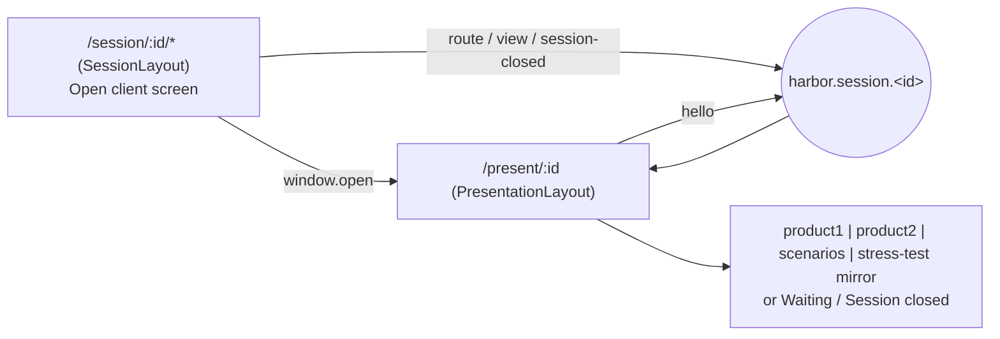

# PRS-001 — Client presentation window synchronised over a session channel

## Summary
In a CLIENT session the representative works in the main window and shows the client a second window on another
screen. The second window (`/present/:sessionId`) has no main navigation, no admin links and no controls; it follows
the representative's current session step and the filters selected there (city, transport mode, stress dimension)
and renders the read-only counterpart of that step with the same data. Synchronisation is browser-local: both
windows belong to the same origin and talk over one `BroadcastChannel` per session, `harbor.session.<sessionId>`;
the backend is not involved and sees the second window only as a second reader of the same session endpoints.
[^channel]

## Actors
| Actor | Role in this feature |
|---|---|
| Representative | opens the client window from the session layout ("Open client screen"), navigates and filters in the main window |
| Client | watches the client window; cannot interact beyond scrolling |
| Presentation window | subscriber: receives `route` / `view` / `session-closed`, re-fetches data through the normal hooks |
| Session window and its pages | publishers: `SessionLayout` (route), product pages and stress page (view), `useCloseSession` (session-closed) |

## Business rules
- **BR-PRS-001-1** — The presentation window MUST be opened per session at `/present/<sessionId>` and MUST render without the main navigation, the session step navigation, admin links and any action control (modal buttons, run buttons, role override, close, report download). [^page] (source: code page#PresentationPage)
- **BR-PRS-001-2** — All cross-window synchronisation MUST go through the channel `harbor.session.<sessionId>`; the application MUST open a `BroadcastChannel` only in `channel.ts` and MUST NOT post messages from any other module. [^channel] (source: code channel#openSessionChannel)
- **BR-PRS-001-3** — The session window MUST publish a `route` message with the current pathname on every navigation inside `/session/<sessionId>/*`. [^channel] (source: code channel#PresentationMessage)
- **BR-PRS-001-4** — Product 1, Product 2 and stress-test pages MUST publish a `view` message whenever the selected city, transport mode or stress dimension changes; each page publishes only its own slice of the view. [^channel] (source: code channel#PresentationView)
- **BR-PRS-001-5** — Closing the session MUST publish `session-closed`; the presentation window MUST then show "Session closed" and stop mirroring. [^channel] (source: code channel#PresentationMessage)
- **BR-PRS-001-6** — A presentation window opened after the meeting started MUST catch up: on subscribe it sends `hello`, and every publisher replays its last `route`, `view` and `session-closed`. [^channel] (source: code channel#PresentationMessage)
- **BR-PRS-001-7** — The presentation window MUST treat incoming messages as untrusted data: it MUST check the message shape before use and MUST ignore unknown types or unknown filter values (unknown city or transport mode falls back to "all"). [^channel] [^page] (source: code channel#isPresentationMessage)
- **BR-PRS-001-8** — For a route without a client counterpart (session summary, non-session routes) and before the first message, the presentation window MUST show the neutral "Waiting for the representative" panel instead of any data. [^page] (source: code page#PresentationPage)
- **BR-PRS-001-9** — The presentation window MUST NOT show client-internal information: the client overview with indicators, the cover quote panel, report preview, modelled-movement and peer-simulation inputs. It renders projection tables, cover ratio chart, scenario list and stress tables only. [^page] (source: code page#PresentationPage)
- **BR-PRS-001-10** — The presentation window MUST read data through the same session-scoped endpoints and the same `X-Harbor-Session` header as the main window; it has no endpoints of its own. ❓ UNVERIFIED that the backend distinguishes the two readers (it does not need to). [^layout] (source: code layout#PresentationLayout)

- **BR-PRS-001-11** **proposed** (request quarterly-view-across-products) — The `view` message MUST carry the
  selected `period` (`MONTH` | `QUARTER`) of the product and stress pages, and the product and stress mirrors MUST
  request their data with that `period` (as BR-PRS-001-4 for the filters; BR-P1-001-12, BR-P2-001-10, BR-STR-001-9).

## UI flow

Routes from `generated/fe/routes.md`: `/present/:sessionId` -> `PresentationLayout` -> `PresentationPage`
(`src/routing/Routing.tsx:43-44`).

| Representative's step | Mirrored by | Data hooks |
|---|---|---|
| `/session/:id/product1` | `ProductMirror` (city as published) | `useProduct1Overview(city)` |
| `/session/:id/product2` | `ProductMirror` (transport mode as published) | `useProduct2Overview(mode)` |
| `/session/:id/scenarios` | `ScenariosMirror` (baseline info, scenario list with shocks) | `useScenarios`, `useBaselinePrices` |
| `/session/:id/stress-test` | `StressMirror` (transport price chart, one table per scenario) | `useStressTest(dimension)` |
| `/session/:id/summary`, anything else | waiting panel | `useSession` only |

## API / Events
| Kind | Name | Purpose | Contract |
|---|---|---|---|
| Channel | `harbor.session.<sessionId>` | cross-window messages `route`, `view`, `session-closed`, `hello` | `fe/src/components/broadcast/sessionChannel.ts` (`PresentationMessage`) |
| REST | `GET /sessions/{sessionId}` | initialise the window's session store (product group, client name, status); owned by SES-001 | `generated/openapi/backend.yaml#/paths/~1sessions~1{sessionId}` |
| REST | `GET /session/product1/overview`, `GET /session/product2/overview` | same calls as the main window's product step; owned by P1-001, P2-001 | `generated/openapi/backend.yaml` |
| REST | `GET /session/scenarios`, `GET /session/market/baseline` | same calls as the scenarios step; owned by MKT-001 | `generated/openapi/backend.yaml` |
| REST | `GET /session/stress-test` | same call as the stress step; owned by STR-001 | `generated/openapi/backend.yaml` |

**proposed** (request quarterly-view-across-products): the mirrored reads carry the `period` query parameter -
`contracts/proposed/quarterly-view-across-products.openapi.yaml` (BR-PRS-001-11).

No Kafka topic and no backend change; the channel is browser-local (same origin, same browser profile).

## Data
None of its own. No table is written; the window only reads through existing endpoints.

## Calculations
None directly. The mirrored tables show `monthly_projection`, `horizon_totals`, `cover_ratio` and `stress_test_monthly` results as
computed for the session; see P1-001, P2-001 (backlog) and STR-001.

## Edge cases
- Window opened before any navigation: waiting panel until the first `route` (or replay after `hello`).
- Representative reloads the main window: publishers re-open the channel; the next navigation republishes.
- Session already CLOSED when the window loads: "Session closed" without subscribing to updates.
- Two presentation windows for one session: both receive the same messages (channel semantics are broadcast).
- Different browser or device for the client screen: BroadcastChannel does not cross browsers; ❓ UNVERIFIED whether a server-relayed variant is required in the real deployment.

## Open questions
- [ ] Does the client screen need its own authorisation (a viewer role) or is sharing the representative's browser session acceptable?
- [ ] Must the mirrored projection hide amounts when the client role is UNDETERMINED (BR of P1-001 / P2-001)?
- [ ] Is a server-relayed channel (WebSocket) needed when the client display is a separate device?
