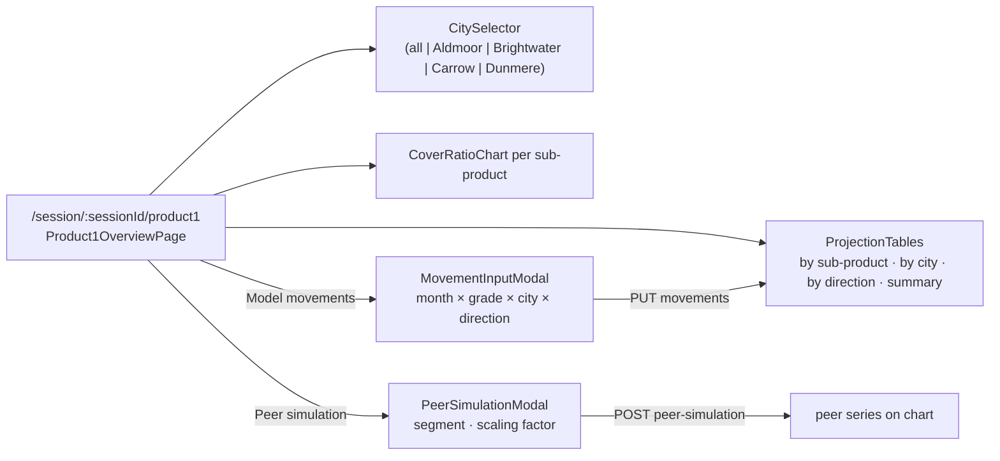

# P1-001 — Product 1 overview — four projection tables, cover charts, movement and peer modals

## Summary
Inside a session for product group `product1` (corridor `VLD <-> NRL`, grades `P1-STD`, `P1-PRM`, `P1-ECO`) the
representative and the client look at the **monthly projection** over the session horizon as four cumulative
tables — by sub-product, by **city** (`Aldmoor`, `Brightwater`, `Carrow`, `Dunmere`), by direction and the summary —
together with the **cover ratio** chart per sub-product. Two modals let the representative enter **modelled
movements** per month and a **peer simulation**; the tables refresh immediately. The same page structure is reused
by Product 2 with transport modes as dimension (P2-001, backlog).

## Actors
| Actor | Role in this feature |
|---|---|
| Representative | Opens the page, selects a city, fills the modals |
| Client | Reads the tables and charts during a `CLIENT` session |
| imports context | Publishes `movements-loaded` which refreshes projections |
| cover context | Supplies cover ratio series via `cover_ratio` |

## Business rules
- **BR-P1-001-1** — `getProduct1Overview` MUST return the four tables `bySubProduct`, `byDimension`
  (`dimension_kind = CITY`), `byDirection` and `summary`, each with one row per month of
  `session_client_config.horizon_months`, plus the cover ratio chart series per sub-product.[^manager][^legacy-tables]
- **BR-P1-001-2** — When the query parameter `city` is given, `byDimension` MUST contain only that city; when it
  is absent, all four cities MUST be returned; an unknown city MUST be rejected with `400`.[^manager]
- **BR-P1-001-3** — The projection MUST be computed with `monthly_projection` from the union of actual
  `movement_monthly` rows and modelled `session_movement_input` rows, where a modelled row replaces the actual row
  with the same `(period, sub_product, city, direction)`.[^service]
- **BR-P1-001-4** — All values MUST use the price basis of `session_client_config.price_basis` (`VLD` or `NRL`) and
  the parameters of `meeting_session.parameter_snapshot`, never live `parameter_set` rows.[^service]
- **BR-P1-001-5** — `putProduct1Movements` MUST replace the complete set of modelled movements of the session
  (PUT semantics); each row MUST have `quantity >= 0`, `unit_price >= 0`, a `period` inside the horizon and a valid
  grade/city/direction, otherwise the whole request MUST be rejected with `400`.[^manager]
- **BR-P1-001-6** — After a successful `putProduct1Movements` the four `projection_*` tables of the session MUST be
  recomputed and persisted before the response is returned.[^service]
- **BR-P1-001-7** — `postProduct1PeerSimulation` MUST store `peer_segment` and `scaling_factor` (default
  `peer.scaling_default` = 1.0, allowed 0.1-5.0) in `session_peer_simulation` and MUST return the peer series as a
  separate chart series that is NOT merged into the projection tables.[^manager]
- **BR-P1-001-8** — On `harbor.imports.movements-loaded` whose `clientIds` contains the client of an `OPEN`
  `product1` session, the listener MUST recompute that session's projection; closed sessions MUST NOT be
  touched.[^service]
- **BR-P1-001-9** — The cover ratio series MUST be computed with `cover_ratio` on the same projection rows and the
  summary table MUST carry `cover_ratio` per month.[^service]
- **BR-P1-001-10** — Every monetary cell MUST be rounded `HALF_EVEN` to scale 2 by the aggregator; the frontend
  MUST NOT round again.[^service]

## UI flow

Hooks: `useProduct1Overview`, `useProduct1Movements`, `usePeerSimulation1` (`fe/src/features/product1/api/`).

## API / Events
| Kind | Name | Purpose | Contract |
|---|---|---|---|
| REST | `GET /session/product1/overview?city=` | `getProduct1Overview` — four tables + cover series | `generated/openapi/backend.yaml#/paths/~1session~1product1~1overview` |
| REST | `PUT /session/product1/movements` | `putProduct1Movements` — modal 1 | `generated/openapi/backend.yaml#/paths/~1session~1product1~1movements` |
| REST | `POST /session/product1/peer-simulation` | `postProduct1PeerSimulation` — modal 2 | `generated/openapi/backend.yaml#/paths/~1session~1product1~1peer-simulation` |
| REST | `GET /session/product1/projection` | `getProduct1Projection` — the four tables only | `generated/openapi/backend.yaml#/paths/~1session~1product1~1projection` |
| Kafka (in) | `harbor.imports.movements-loaded` | refresh projections of open sessions | `generated/asyncapi/backend.yaml#/channels/harbor.imports.movements-loaded` |

All four REST operations require `X-Harbor-Session` (MTG-001 BR-5).

## Data
| Table | Use |
|---|---|
| `movement_monthly` | read: actual rows for the client, `product_group = product1` (BR-3) |
| `session_movement_input` | written by BR-5; read by BR-3 |
| `session_peer_simulation` | written by BR-7 |
| `projection_by_subproduct` | `session_id, period, sub_product, quantity, value, landed_cost, cumulative_value` |
| `projection_by_dimension` | same with `dimension_kind = CITY`, `dimension_value` |
| `projection_by_direction` | same with `direction` |
| `projection_summary` | `total_quantity, total_value, total_landed_cost, cover_ratio, cumulative_value` (BR-1, BR-9) |
| `cover_policy` | read for the cover ratio (BR-9) |
| `session_client_config` | read: `horizon_months`, `price_basis` (BR-1, BR-4) |

## Calculations
- [monthly_projection](/domain/calculations/monthly_projection.md) → BR-P1-001-3, BR-P1-001-6, BR-P1-001-10
- [cover_ratio](/domain/calculations/cover_ratio.md) → BR-P1-001-9

## Edge cases
- No actual movements and no modelled rows → tables with zero rows per month, cover ratio `0.0000`.
- Modelled row for a city outside the four hubs → `400` (BR-5), not silently dropped.
- `movements-loaded` arrives while a `PUT movements` transaction is running → the listener's recompute runs after
  commit (row lock on `projection_summary` by `session_id`).
- The legacy page lists three tables only; the **summary** table was added with the cover ratio column.[^legacy-tables]

## Open questions
- [ ] Should the peer series be included in the report payload (RPT-001)? Currently it is not.

## Change log
| Date | Change | Ref |
|---|---|---|
| 2026-10-09 | Rebuilt for the Harbor bundle | — |

[^manager]: Product1Manager.kt (harbor-backend, `core`, layer `manager`)
[^service]: ProjectionService.kt (harbor-backend, `core`, layer `service`)
[^legacy-tables]: Legacy page HARBOR/Product 1 overview tables (2025-07-21) — three tables only, no summary table
