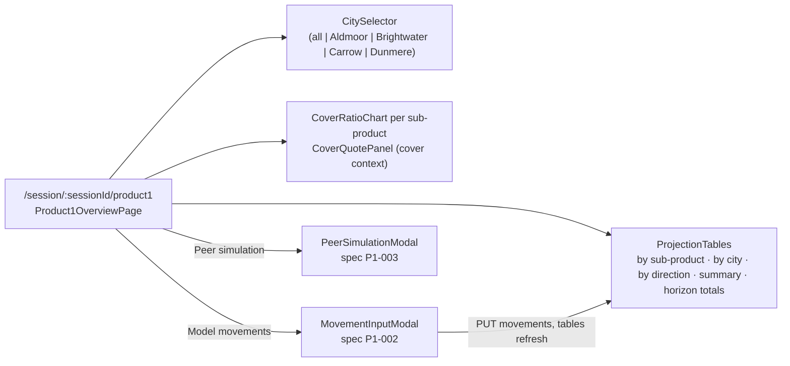

# P1-001 — Product 1 overview — four projection tables, cover charts, city filter

## Summary
Inside a session for product group `product1` (corridor `VLD <-> NRL`, grades `P1-STD`, `P1-PRM`, `P1-ECO`) the
representative and the client look at the **monthly projection** over the session horizon as four cumulative
tables — by sub-product, by **city** (`Aldmoor`, `Brightwater`, `Carrow`, `Dunmere`), by direction and the summary —
together with the **cover ratio** chart per sub-product and the cover quote panel of the cover context. Two
buttons open modals with their own specs: **Model movements** ([P1-002](/features/product1/P1-002.md), modelled
movements per month) and **Peer simulation** ([P1-003](/features/product1/P1-003.md)); a saved movement set
refreshes the tables of this screen immediately. The same screen structure is reused by Product 2 with transport
modes as dimension ([P2-001](/features/product2/P2-001.md)).

## Actors
| Actor | Role in this feature |
|---|---|
| Representative | Opens the screen, selects a city, opens the two modals |
| Client | Reads the tables and charts during a `CLIENT` session |
| imports context | Publishes `movements-loaded` which refreshes projections |
| cover context | Supplies cover ratio series via `cover_ratio` and renders the cover quote panel |

## Business rules
- **BR-P1-001-1** — `getProduct1Overview` MUST return the four tables `bySubProduct`, `byDimension`
  (`dimension_kind = CITY`), `byDirection` and `summary`, each with one row per month of
  `session_client_config.horizon_months`, plus the cover ratio chart series per sub-product.[^manager][^legacy-tables]
- **BR-P1-001-2** — When the query parameter `city` is given, `byDimension` MUST contain only that city; when it
  is absent, all four cities MUST be returned; an unknown city MUST be rejected with `400`.[^manager]
- **BR-P1-001-3** — The projection MUST be computed with `monthly_projection` from the union of actual
  `movement_monthly` rows and modelled `session_movement_input` rows, where a modelled row replaces the actual row
  with the same `(period, sub_product, city, direction)`.[^service]
- **BR-P1-001-4** — All values MUST use the price basis of `session_client_config.price_basis` (`VLD` or `NRL`) and
  the parameters of `meeting_session.parameter_snapshot`, never live `parameter_set` rows.[^service]
- **BR-P1-001-5** — withdrawn, moved to BR-P1-002-1 and BR-P1-002-2 (movement modal, 2026-10-15).
- **BR-P1-001-6** — withdrawn, moved to BR-P1-002-3 (movement modal, 2026-10-15).
- **BR-P1-001-7** — withdrawn, moved to BR-P1-003-1 and BR-P1-003-3 (peer simulation modal, 2026-10-15).
- **BR-P1-001-8** — On `harbor.imports.movements-loaded` whose `clientIds` contains the client of an `OPEN`
  `product1` session, the listener MUST recompute that session's projection; closed sessions MUST NOT be
  touched.[^service]
- **BR-P1-001-9** — The cover ratio series MUST be computed with `cover_ratio` on the same projection rows and the
  summary table MUST carry `cover_ratio` per month.[^service]
- **BR-P1-001-10** — Every monetary cell MUST be rounded `HALF_EVEN` to scale 2 by the aggregator; the frontend
  MUST NOT round again.[^service]
- **BR-P1-001-11** — Every response carrying `tables` (`getProduct1Overview`, `getProduct1Projection`,
  `putProduct1Movements`) MUST also carry `tables.totals`, computed with `horizon_totals` from the same four tables:
  one line per sub-product, city and direction summed over the whole horizon (`quantity`, `value`, `landedCost`,
  `shareOfValue`) plus the overall line `ALL`. The totals MUST be derived from the persisted monthly lines, never
  stored separately, and the screen MUST show them as three separate tables below the monthly ones.[^service]

## UI flow

Hooks of this screen: `useProduct1Overview`, `useProduct1Projection` (`fe/src/pages/Product1OverviewPage/hook/useProduct1Overview.ts`).
The modals are rendered by this screen and specified in [P1-002](/features/product1/P1-002.md) and
[P1-003](/features/product1/P1-003.md); the city filter is mirrored to the client window ([PRS-001](/features/presentation/PRS-001.md)).

## API / Events
| Kind | Name | Purpose | Contract |
|---|---|---|---|
| REST | `GET /session/product1/overview?city=` | `getProduct1Overview` — four tables + cover series | `generated/openapi/backend.yaml#/paths/~1session~1product1~1overview` |
| REST | `GET /session/product1/projection` | `getProduct1Projection` — the four tables only | `generated/openapi/backend.yaml#/paths/~1session~1product1~1projection` |
| Kafka (in) | `harbor.imports.movements-loaded` | refresh projections of open sessions | `generated/asyncapi/backend.yaml#/channels/harbor.imports.movements-loaded` |

Both REST operations require `X-Harbor-Session` (SES-001 BR-5). The modal operations `PUT /session/product1/movements`
and `POST /session/product1/peer-simulation` are specified in P1-002 and P1-003.

## Data
| Table | Use |
|---|---|
| `movement_monthly` | read: actual rows for the client, `product_group = product1` (BR-3) |
| `session_movement_input` | read by BR-3; written by the movement modal (P1-002) |
| `projection_by_subproduct` | `session_id, period, sub_product, quantity, value, landed_cost, cumulative_value` |
| `projection_by_dimension` | same with `dimension_kind = CITY`, `dimension_value` |
| `projection_by_direction` | same with `direction` |
| `projection_summary` | `total_quantity, total_value, total_landed_cost, cover_ratio, cumulative_value` (BR-1, BR-9) |
| `cover_policy` | read for the cover ratio (BR-9) |
| `session_client_config` | read: `horizon_months`, `price_basis` (BR-1, BR-4) |

## Calculations
- [monthly_projection](/domain/calculations/monthly_projection.md) → BR-P1-001-3, BR-P1-001-10
- [cover_ratio](/domain/calculations/cover_ratio.md) → BR-P1-001-9
- [horizon_totals](/domain/calculations/horizon_totals.md) → BR-P1-001-11

## Edge cases
- No actual movements and no modelled rows → tables with zero rows per month, cover ratio `0.0000`.
- The legacy page lists three tables only; the **summary** table was added with the cover ratio column.[^legacy-tables]
- Validation and concurrency of the movement save: P1-002 edge cases.

## Legacy page: Product 1 overview tables (2025-07-21)
Merged on 2026-10-12 (Run 2, confluence-migrator). The page is evidence only; it is kept under `confluence-import/HARBOR/_done/`.[^legacy-tables]
- Confirms BR-P1-002-1 (saving replaces all modelled movements of the session), BR-P1-003-3 (the peer series is
  a separate series, not merged into the tables), the default horizon of 24 months, and the value and landed cost
  formulas of `monthly_projection`.
- Legacy lists three tables (by grade, by city, by direction); the summary table and the horizon totals are newer
  and absent from the page. Legacy layout is one column per grade or city; the current tables have one row per
  month and key. Legacy shows one cover chart per grade; the screen shows one chart with one series per sub-product
  (`CoverRatioChart`). Layout changes, no rule change.

> ⚠️ CONFLICT (legacy: product1-overview-tables, "every column is cumulative") — only `cumulativeValue` is
> cumulative; `quantity`, `value` and `landedCost` are per month (BR-P1-001-1, `monthly_projection`). The legacy
> wording is obsolete.

> ⚠️ CONFLICT (legacy: product1-overview-tables, "the city selector restricts Table 2 only; the other tables are not
> affected") — `getProduct1Overview?city=` filters the movement rows **before** aggregation (`Product1Manager.overview`,
> L39), so all four tables and the totals shrink to that city. BR-P1-001-2 names only `byDimension`. Owner decision
> needed (Open questions).

## Open questions
- [ ] City filter scope (owner: harbor-platform-team) — legacy: only the city table is filtered; code: all four
  tables and the totals; BR-P1-001-2 is silent on the other three. Decide, then sharpen BR-2 and the frontend label.
- [ ] Replacement granularity and grid start (owner: harbor-platform-team) — see `monthly_projection` audit Q1 and
  Q2: BR-P1-001-3 says per key, the code replaces the whole month; the grid starts the month after today, not at
  session start.

## Change log
| Date | Change | Ref |
|---|---|---|
| 2026-10-09 | Rebuilt for the Harbor bundle | — |
| 2026-10-12 | BR-P1-001-11: horizon totals (`horizon_totals`) returned as `tables.totals` and shown as three separate tables under the monthly ones | — |
| 2026-10-15 | Modal rules carved out: BR-5 and BR-6 → P1-002 (movement modal), BR-7 → P1-003 (peer simulation); this spec is the screen only (`features/conventions.md`, "Shaping specs") | — |
