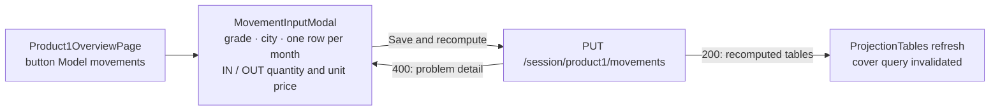

# P1-002 — Modelled movements — the movement modal of the Product 1 overview

## Summary
From the Product 1 overview ([P1-001](/features/product1/P1-001.md)) the representative opens **Model movements**:
one row per month of the projection grid with IN and OUT quantity and unit price for a chosen grade and city.
Saving replaces the session's modelled movements as a whole, validates every row, recomputes the four projection
tables and returns them, so the screen refreshes at once. The component is shared with Product 2
([P2-002](/features/product2/P2-002.md)), which passes the transport mode as dimension instead of the city; the
rules below are the Product 1 ones.

## Actors
| Actor | Role in this feature |
|---|---|
| Representative | Opens the modal, fills the rows, saves |
| Client | Sees the refreshed tables (and, on the client screen, the same tables through PRS-001) |
| product1 screen (P1-001) | Renders the modal and shows the recomputed tables |

## Business rules
- **BR-P1-002-1** — `putProduct1Movements` MUST replace the complete set of modelled movements of the session (PUT
  semantics): rows absent from the request MUST be deleted, rows present MUST be stored as sent.[^service][^legacy-tables]
- **BR-P1-002-2** — Every row MUST have a `period` inside the session horizon, a `subProduct` of the session's
  product group, `quantity > 0`, `unitPrice >= 0` and a `city` among the four hubs; otherwise the whole request MUST
  be rejected with `400` and no modelled row of the session MUST change.[^validator][^manager]
- **BR-P1-002-3** — After a successful save the four `projection_*` tables of the session MUST be recomputed with
  `monthly_projection` and persisted before the response is returned, and the response MUST carry the recomputed
  tables (with `tables.totals`, BR-P1-001-11).[^service]
- **BR-P1-002-4** — The modal MUST offer exactly the months of the projection grid (the month after the current
  one, `horizon_months` rows) and MUST NOT send empty cells.[^modal]
- **BR-P1-002-5** — When the backend rejects the save, the modal MUST stay open and show the problem detail; the
  save MUST NOT be retried automatically.[^modal]

## UI flow

Hook: `useProduct1Movements` (`fe/src/pages/Product1OverviewPage/hook/useProduct1Movements.ts`): on success it stores the
returned projection in the query cache and invalidates the `product1` and `cover` queries of the session.

## API / Events
| Kind | Name | Purpose | Contract |
|---|---|---|---|
| REST | `PUT /session/product1/movements` | `putProduct1Movements` — replace the modelled set, recompute, return tables | `generated/openapi/backend.yaml#/paths/~1session~1product1~1movements` |

Requires `X-Harbor-Session` (SES-001 BR-5).

## Data
| Table | Use |
|---|---|
| `session_movement_input` | written: delete all rows of the session, insert the request rows (BR-1) |
| `projection_by_subproduct`, `projection_by_dimension`, `projection_by_direction`, `projection_summary` | recomputed and replaced (BR-3) |
| `session_client_config` | read: `horizon_months` for the grid (BR-2, BR-4) |

## Calculations
- [monthly_projection](/domain/calculations/monthly_projection.md) → BR-P1-002-3 (how a modelled row replaces an actual one: BR-P1-001-3)

## Edge cases
- Empty list → all modelled rows deleted; the projection is recomputed from actual movements only (BR-1, BR-3).
- Row with `quantity = 0` → `400` ("quantity must be positive", BR-2); see Open questions.
- City outside the four hubs, or a Product 2 sub-product → `400`, nothing changed (BR-2).
- `movements-loaded` arrives while the save transaction runs → the listener's recompute (BR-P1-001-8) runs after
  commit (row lock on `projection_summary` by `session_id`).

## Open questions
- [ ] Zero quantity (owner: harbor-platform-team) — the former BR-P1-001-5 said `quantity >= 0`; the validator
  rejects 0. Is a zero row a deletion of the actual row or an error? Decide, then align BR-2 and the modal help text.
- [ ] Partial failure feedback (owner: harbor-platform-team) — the problem detail names the first invalid row only;
  should the modal highlight the row?

## Change log
| Date | Change | Ref |
|---|---|---|
| 2026-10-15 | Carved out of P1-001: former BR-P1-001-5 → BR-1 and BR-2, former BR-P1-001-6 → BR-3; BR-4 and BR-5 from work item P1-001 S7 (grid months, rejected save) | — |
