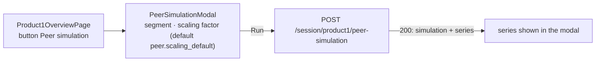

# P1-003 — Peer simulation — the peer modal of the Product 1 overview

## Summary
From the Product 1 overview ([P1-001](/features/product1/P1-001.md)) the representative opens **Peer simulation**,
picks a peer segment and optionally a scaling factor, and sees what similar firms move month by month: the segment
median of the last 12 full months scaled by the factor ([peer_benchmark_simulation](/domain/calculations/peer_benchmark_simulation.md)).
Every run is recorded for the session; the series itself is shown in the modal and is not stored and not merged
into the projection. The modal component is shared with Product 2 ([P2-003](/features/product2/P2-003.md)).

## Actors
| Actor | Role in this feature |
|---|---|
| Representative | Opens the modal, chooses segment and factor, runs the simulation |
| admin context | Owns the parameter `peer.scaling_default` (ADM-001) |
| product1 screen (P1-001) | Renders the modal |

## Business rules
- **BR-P1-003-1** — `postProduct1PeerSimulation` MUST record `peer_segment`, `scaling_factor` and `generated_at` in
  `session_peer_simulation` for every run; when `scalingFactor` is absent the parameter `peer.scaling_default`
  (1.0) MUST be used and recorded.[^peer]
- **BR-P1-003-2** — `scalingFactor` MUST be positive; zero or a negative value MUST be rejected and nothing MUST be
  recorded.[^peer]
- **BR-P1-003-3** — The series MUST be computed with `peer_benchmark_simulation` over the last 12 full months of
  the clients of the segment and returned as a separate series; it MUST NOT be merged into the projection tables
  and MUST NOT be stored.[^peer][^manager][^legacy-tables]

## UI flow

Hook: `usePeerSimulation1` (`fe/src/features/product1/api/usePeerSimulation1.ts`); on success it invalidates the
`product1` queries of the session.

## API / Events
| Kind | Name | Purpose | Contract |
|---|---|---|---|
| REST | `POST /session/product1/peer-simulation` | `postProduct1PeerSimulation` — record the run, return the series | `generated/openapi/backend.yaml#/paths/~1session~1product1~1peer-simulation` |

Requires `X-Harbor-Session` (SES-001 BR-5).

## Data
| Table | Use |
|---|---|
| `session_peer_simulation` | written: one row per run (BR-1) |
| `movement_monthly` | read: rows of the segment's clients over the last 12 full months (BR-3) |

## Calculations
- [peer_benchmark_simulation](/domain/calculations/peer_benchmark_simulation.md) → BR-P1-003-3 (draft; definition not yet approved)

## Edge cases
- Segment without clients or without movements → an empty series, the run is still recorded (BR-1).
- Factor omitted → the parameter value is used and recorded, so the row shows what was applied (BR-1).

## Open questions
- [ ] Allowed range of the factor (owner: harbor-platform-team) — the former BR-P1-001-7 claimed 0.1 to 5.0; the
  contract type `Ratio` has no bounds and the code only requires a positive value. Decide the range and put it
  into the contract, or drop the claim.
- [ ] Error mapping (owner: harbor-platform-team) — a non-positive factor fails inside the service; confirm the
  HTTP status the client receives and name it in BR-2.
- [ ] Peer benchmark definition (owner: harbor-platform-team) — `peer_benchmark_simulation` records the current
  code (segment median × factor, quantities only); confirm or specify the intended rule.
- [ ] Should the peer series be included in the report payload (RPT-001)? Currently it is not.

## Change log
| Date | Change | Ref |
|---|---|---|
| 2026-10-15 | Carved out of P1-001: former BR-P1-001-7 → BR-1 and BR-3; BR-2 from the service; range claim moved to Open questions | — |
