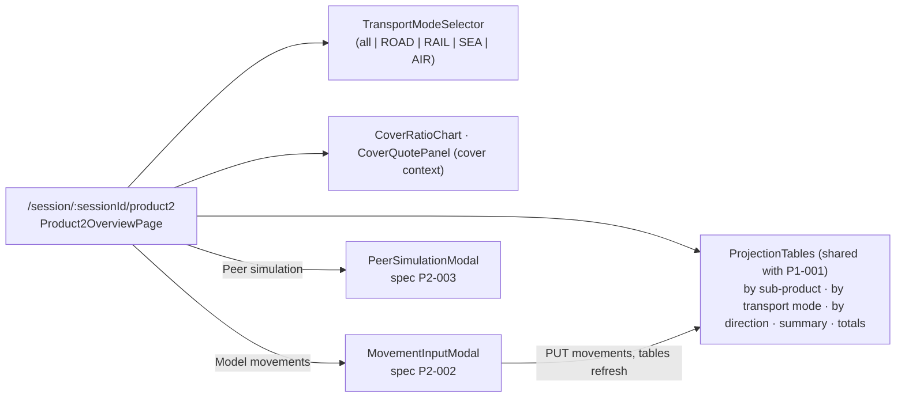

# P2-001 — Product 2 overview — four projection tables, cover charts, transport mode filter

## Summary
Inside a session for product group `product2` (corridor `CST <-> MRD`, sub-products `P2-S`, `P2-M`, `P2-L`) the
representative and the client look at the same four cumulative projection tables as on the Product 1 screen, with
the **transport mode** (`ROAD`, `RAIL`, `SEA`, `AIR`) as the breakdown dimension instead of the city, the cover
ratio chart per sub-product and the cover quote panel. The screen reuses the Product 1 components
(`ProjectionTables`, `CoverRatioChart`, both modals) and the shared projection pipeline; only the filter, the
dimension and the Product 2 manager differ. The modals are specified in [P2-002](/features/product2/P2-002.md) and
[P2-003](/features/product2/P2-003.md). Mirrored spec: a rule written "as BR-P1-001-n" is identical to that Product 1
rule except for what the sentence names.

## Actors
| Actor | Role in this feature |
|---|---|
| Representative | Opens the screen, selects a transport mode, opens the two modals |
| Client | Reads the tables and charts during a `CLIENT` session |
| imports context | Publishes `movements-loaded` which refreshes projections |
| cover context | Supplies cover ratio series via `cover_ratio` and renders the cover quote panel |

## Business rules
- **BR-P2-001-1** — as BR-P1-001-1 for `getProduct2Overview`, with `byDimension` carrying
  `dimension_kind = TRANSPORT_MODE`.[^manager] (source: spec BR-P1-001-1)
- **BR-P2-001-2** — When the query parameter `transportMode` is given, the projection MUST be computed from the
  rows of that mode only; when absent, all modes MUST be returned; a value outside `ROAD`, `RAIL`, `SEA`, `AIR` MUST
  be rejected by the contract with `400`.[^manager] (source: code manager#overview)
- **BR-P2-001-3** — as BR-P1-001-3, with the replacement key `(period, sub_product, transport_mode, direction)`.[^manager] (source: spec BR-P1-001-3)
- **BR-P2-001-4** — as BR-P1-001-4, with the price basis `CST` or `MRD`.[^manager] (source: spec BR-P1-001-4)
- **BR-P2-001-5** — A request on a session whose product group is not `product2` MUST be rejected with `400`
  ("not a Product 2 session").[^manager] (source: code manager#requireProduct)
- **BR-P2-001-6** — On `harbor.imports.movements-loaded` whose `clientIds` contains the client of an `OPEN`
  `product2` session, the Product 2 listener (consumer group `harbor-product2`, independent of the Product 1 one)
  MUST recompute that session's projection; closed sessions MUST NOT be touched.[^listener] (source: code listener#onMovementsLoaded)
- **BR-P2-001-7** — as BR-P1-001-9 (cover ratio series and `summary.cover_ratio`).[^manager] (source: spec BR-P1-001-9)
- **BR-P2-001-8** — as BR-P1-001-10 (rounding by the aggregator only).[^manager] (source: spec BR-P1-001-10)
- **BR-P2-001-9** — as BR-P1-001-11 (`tables.totals` by sub-product, transport mode and direction, shown as three
  tables below the monthly ones).[^manager] (source: spec BR-P1-001-11)
- **BR-P2-001-10** **proposed** (request quarterly-view-across-products) — as BR-P1-001-12 for `getProduct2Overview`
  and `getProduct2Projection` (`period = MONTH | QUARTER`, quarterly rows from `quarterly_rollup`, totals unchanged,
  period kept into the stress test).

## UI flow

Hooks: `useProduct2Overview`, `useProduct2Projection` (`fe/src/pages/Product2OverviewPage/hook/useProduct2Overview.ts`). The
transport mode filter is mirrored to the client window ([PRS-001](/features/presentation/PRS-001.md) BR-4).

## API / Events
| Kind | Name | Purpose | Contract |
|---|---|---|---|
| REST | `GET /session/product2/overview?transportMode=` | `getProduct2Overview` — four tables + cover series | `generated/openapi/backend.yaml#/paths/~1session~1product2~1overview` |
| REST | `GET /session/product2/projection` | `getProduct2Projection` — the four tables only | `generated/openapi/backend.yaml#/paths/~1session~1product2~1projection` |
| Kafka (in) | `harbor.imports.movements-loaded` | refresh projections of open sessions | `generated/asyncapi/backend.yaml#/channels/harbor.imports.movements-loaded` |

Both REST operations require `X-Harbor-Session` (SES-001 BR-5). The modal operations are in P2-002 and P2-003.
**proposed** (request quarterly-view-across-products): both operations gain the query parameter `period` -
`contracts/proposed/quarterly-view-across-products.openapi.yaml#/paths/~1session~1product2~1overview` (BR-P2-001-10).

## Data
| Table | Use |
|---|---|
| `movement_monthly` | read: actual rows for the client, `product_group = product2` (BR-3) |
| `session_movement_input` | read by BR-3 (`transport_mode` column); written by P2-002 |
| `projection_by_subproduct`, `projection_by_direction`, `projection_summary` | as P1-001 |
| `projection_by_dimension` | `dimension_kind = TRANSPORT_MODE`, `dimension_value` = the mode |
| `cover_policy` | read for the cover ratio (BR-7) |
| `session_client_config` | read: `horizon_months`, `price_basis` (BR-1, BR-4) |

## Calculations
- [monthly_projection](/domain/calculations/monthly_projection.md) → BR-P2-001-3, BR-P2-001-8
- [cover_ratio](/domain/calculations/cover_ratio.md) → BR-P2-001-7
- [horizon_totals](/domain/calculations/horizon_totals.md) → BR-P2-001-9
- [quarterly_rollup](/domain/calculations/quarterly_rollup.md) → BR-P2-001-10 (proposed)

## Edge cases
- No actual movements and no modelled rows → tables with zero rows per month, cover ratio `0.0000`.
- Filter by a mode with no rows → empty tables for that mode, totals zero (BR-2).
- A Product 1 session calling a Product 2 operation → `400` (BR-5).

## Open questions
- [ ] Filter scope (owner: harbor-platform-team) — as for P1-001: the filter is applied before aggregation, so all
  four tables and the totals shrink to the mode; confirm this is intended for Product 2 as well.
- [ ] No legacy page has been merged for Product 2 (Run 2 pending); the Product 1 page covers the table layout only.
