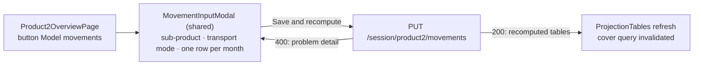

# P2-002 — Modelled movements — the movement modal of the Product 2 overview

## Summary
The Product 2 overview ([P2-001](/features/product2/P2-001.md)) renders the Product 1 `MovementInputModal` with
`dimension = transportMode`: one row per month with IN and OUT quantity and unit price for a chosen sub-product
(`P2-S`, `P2-M`, `P2-L`) and transport mode (`ROAD`, `RAIL`, `SEA`, `AIR`). Saving goes to the Product 2 manager and
the shared projection pipeline. Mirrored spec of [P1-002](/features/product1/P1-002.md): a rule written
"as BR-P1-002-n" is identical except for what the sentence names.

## Actors
| Actor | Role in this feature |
|---|---|
| Representative | Opens the modal, fills the rows, saves |
| Client | Sees the refreshed tables |
| product2 screen (P2-001) | Renders the shared modal with the transport mode dimension |

## Business rules
- **BR-P2-002-1** — as BR-P1-002-1 for `putProduct2Movements` (replace the complete modelled set of the session).[^manager]
- **BR-P2-002-2** — Every row MUST have a `period` inside the session horizon, a `subProduct` of `product2`,
  `quantity > 0`, `unitPrice >= 0` and a `transportMode`; otherwise the whole request MUST be rejected with `400`
  and no modelled row of the session MUST change.[^validator][^manager]
- **BR-P2-002-3** — as BR-P1-002-3 (recompute and persist the four tables before the response; totals included).[^manager]
- **BR-P2-002-4** — as BR-P1-002-4 (exactly the grid months; empty cells not sent).[^page]
- **BR-P2-002-5** — as BR-P1-002-5 (a rejected save keeps the modal open with the problem detail).[^page]

## UI flow

Hook: `useProduct2Movements` (`fe/src/pages/Product2OverviewPage/hook/useProduct2Movements.ts`).

## API / Events
| Kind | Name | Purpose | Contract |
|---|---|---|---|
| REST | `PUT /session/product2/movements` | `putProduct2Movements` — replace the modelled set, recompute, return tables | `generated/openapi/backend.yaml#/paths/~1session~1product2~1movements` |

Requires `X-Harbor-Session` (SES-001 BR-5).

## Data
| Table | Use |
|---|---|
| `session_movement_input` | written: delete all rows of the session, insert the request rows; `transport_mode` filled, `city` null (BR-1, BR-2) |
| `projection_by_subproduct`, `projection_by_dimension`, `projection_by_direction`, `projection_summary` | recomputed and replaced (BR-3) |
| `session_client_config` | read: `horizon_months` for the grid (BR-2, BR-4) |

## Calculations
- [monthly_projection](/domain/calculations/monthly_projection.md) → BR-P2-002-3

## Edge cases
- Row with a `city` instead of a `transportMode` → `400` (BR-2).
- Otherwise as P1-002.

## Open questions
- [ ] The open questions of P1-002 (zero quantity, partial failure feedback) apply unchanged; decide them once.

## Change log
| Date | Change | Ref |
|---|---|---|
| 2026-10-15 | Created as the mirror of P1-002 | — |
