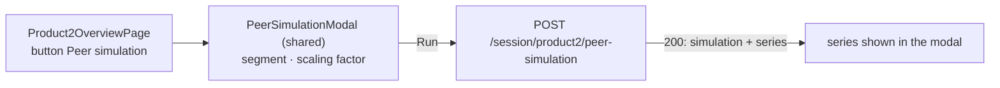

# P2-003 — Peer simulation — the peer modal of the Product 2 overview

## Summary
The Product 2 overview ([P2-001](/features/product2/P2-001.md)) renders the Product 1 `PeerSimulationModal`; the run
goes through `postProduct2PeerSimulation` and the shared `PeerSimulationService`, which reads the segment's movements
of the session's product group (`product2`). Mirrored spec of [P1-003](/features/product1/P1-003.md).

## Actors
| Actor | Role in this feature |
|---|---|
| Representative | Opens the modal, chooses segment and factor, runs the simulation |
| admin context | Owns the parameter `peer.scaling_default` (ADM-001) |
| product2 screen (P2-001) | Renders the shared modal |

## Business rules
- **BR-P2-003-1** — as BR-P1-003-1 for `postProduct2PeerSimulation` (record segment, factor and time; default from
  `peer.scaling_default`).[^peer][^manager] (source: spec BR-P1-003-1)
- **BR-P2-003-2** — as BR-P1-003-2 (factor must be positive).[^peer] (source: spec BR-P1-003-2)
- **BR-P2-003-3** — as BR-P1-003-3, over the `product2` movements of the segment's clients.[^peer][^manager] (source: spec BR-P1-003-3)

## UI flow

Hook: `usePeerSimulation2` (`fe/src/pages/Product2OverviewPage/hook/usePeerSimulation2.ts`).

## API / Events
| Kind | Name | Purpose | Contract |
|---|---|---|---|
| REST | `POST /session/product2/peer-simulation` | `postProduct2PeerSimulation` — record the run, return the series | `generated/openapi/backend.yaml#/paths/~1session~1product2~1peer-simulation` |

Requires `X-Harbor-Session` (SES-001 BR-5).

## Data
| Table | Use |
|---|---|
| `session_peer_simulation` | written: one row per run (BR-1) |
| `movement_monthly` | read: `product2` rows of the segment's clients over the last 12 full months (BR-3) |

## Calculations
- [peer_benchmark_simulation](/domain/calculations/peer_benchmark_simulation.md) → BR-P2-003-3

## Edge cases
- As P1-003.

## Open questions
- [ ] The open questions of P1-003 (factor range, error mapping, benchmark definition, report payload) apply
  unchanged; decide them once.
