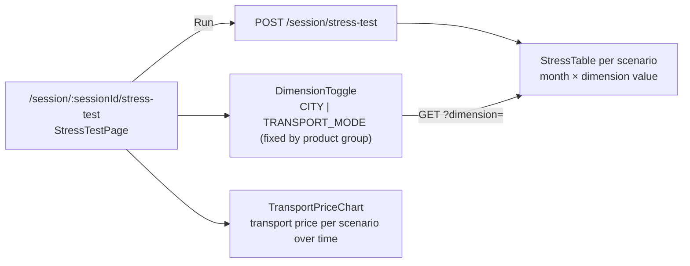

# STR-001 — Stress test per scenario and dimension

> **Draft** — content derived from `StressManager.kt` / `StressTestService.kt`; awaiting verification against code
> and resolution of the conflict with the legacy page (see Open questions).

## Summary
On the **Stress test** page the representative runs all market scenarios of the session
([MKT-001](/features/market/MKT-001.md)) against the current projection and sees, per scenario, a monthly table of
`exposure`, `transport cost delta` and `cumulative exposure` broken down by **dimension** — city for Product 1,
transport mode for Product 2 — plus a chart of the transport price over time per scenario. The sign of the exposure
follows the client's effective role (importer pays more when prices rise, exporter earns more).

## Actors
| Actor | Role in this feature |
|---|---|
| Representative | Runs the stress test, toggles the dimension, explains results |
| Client | Reads the table and chart |
| market context | Provides scenarios and baseline curve |
| product1 / product2, cover contexts | Provide projection rows and uncovered quantity |

## Business rules
- **BR-STR-001-1** — `runStressTest` MUST compute `stress_test_monthly` for every `market_scenario` of the session,
  every month of the horizon and every dimension value, and MUST replace all previous `stress_test_result` rows of
  the session in one transaction.[^service]
- **BR-STR-001-2** — The sign of the exposure MUST follow the session's effective role:
  `meeting_session.role_override` when set, otherwise the result of `client_role_classification` with
  `role.importer_threshold` 0.65 and `role.exporter_threshold` 0.35 from the parameter snapshot; `MIXED` and
  `UNDETERMINED` MUST use the net direction quantity.[^service]
- **BR-STR-001-3** — `cumulative_exposure` MUST be the running sum of `exposure + transport_cost_delta`; the
  transport cost delta MUST be computed on the total quantity, not the uncovered quantity.[^service]
- **BR-STR-001-4** — Scenario prices MUST come from `scenario_price_path`; the baseline scenario (no shocks) MUST
  always be included and yields zero exposure.[^service]
- **BR-STR-001-5** — `getStressTest` MUST accept `dimension = CITY` for a `product1` session and `TRANSPORT_MODE`
  for a `product2` session; the other combination MUST be rejected with `400`.[^manager]
- **BR-STR-001-6** — `getStressTest` on a session without a prior run MUST return `200` with an empty result and
  `lastRunAt = null`, not `404`.[^manager]
- **BR-STR-001-7** — All amounts MUST be rounded `HALF_EVEN` to `stress.rounding_scale` (2) before
  persistence.[^service]
- **BR-STR-001-8** — Both operations MUST require `X-Harbor-Session`; a missing header MUST yield `428`
  (SES-001 BR-5).[^manager]
- **BR-STR-001-9** **proposed** (request quarterly-view-across-products) — `getStressTest` MUST accept the query
  parameter `period = MONTH | QUARTER` (default `MONTH`); with `QUARTER` each scenario table MUST carry one row per
  calendar quarter and dimension value, `exposure` and `transport_cost_delta` summed over the quarter's months and
  `cumulative_exposure` taken from the quarter's last month, computed with `quarterly_rollup` from the stored
  monthly rows; `runStressTest` and the stored rows MUST stay monthly.

## UI flow

Hooks: `useStressTest`, `useRunStressTest` (`fe/src/pages/StressTestPage/hook/`).

## API / Events
| Kind | Name | Purpose | Contract |
|---|---|---|---|
| REST | `POST /session/stress-test` | `runStressTest` — computes all scenarios | `generated/openapi/backend.yaml#/paths/~1session~1stress-test` |
| REST | `GET /session/stress-test?dimension=` | `getStressTest` — table + chart series | `generated/openapi/backend.yaml#/paths/~1session~1stress-test` |

**proposed** (request quarterly-view-across-products): `getStressTest` gains the query parameter `period` -
`contracts/proposed/quarterly-view-across-products.openapi.yaml#/paths/~1session~1stress-test` (BR-STR-001-9).

## Data
| Table | Use |
|---|---|
| `stress_test_result` | `session_id, scenario_id, period, dimension_value, exposure, transport_cost_delta, cumulative_exposure` — written by BR-1 |
| `market_scenario` | read: scenarios and `shocks` (BR-1, BR-4) |
| `baseline_price` | read: baseline price and transport price (BR-4) |
| `projection_by_dimension`, `projection_by_direction`, `projection_summary` | read: quantities, cover ratio → uncovered quantity (BR-3) |
| `meeting_session` | read: `role_override`, `parameter_snapshot` (BR-2) |

## Calculations
- [stress_test_monthly](/domain/calculations/stress_test_monthly.md) → BR-STR-001-1, BR-STR-001-3, BR-STR-001-7
- [scenario_price_path](/domain/calculations/scenario_price_path.md) → BR-STR-001-4
- [client_role_classification](/domain/calculations/client_role_classification.md) → BR-STR-001-2
- [quarterly_rollup](/domain/calculations/quarterly_rollup.md) → BR-STR-001-9 (proposed)

## Edge cases
- Session without scenarios → only the baseline scenario, all exposures 0.
- Cover ratio 1.0 for a month → exposure 0, transport cost delta still non-zero (BR-3).
- Scenario deleted after a run → its `stress_test_result` rows are removed by cascade; the table shows the
  remaining scenarios.

## Open questions
- [ ] Legacy page says the importer threshold is **0.5** and the stress formula **ignores the transport cost delta**
  — the code (`RoleClassifier`, `StressTestCalculator`) says **0.65** and **includes** it; confirm with the product
  owner which is intended before promoting this spec to `stable`.[^legacy-calc]
- [ ] Should `UNDETERMINED` be rejected with `409` instead of being treated as `MIXED`?

## Change log
| Date | Change | Ref |
|---|---|---|
| 2026-10-09 | Draft created for the Harbor bundle | — |
| 2026-10-20 | BR-STR-001-9 proposed (quarterly view, `period` parameter) by the request analysis `work-items/quarterly-view-across-products.md` | — |

[^manager]: StressManager.kt (harbor-backend, `core`, layer `manager`)
[^service]: StressTestService.kt (harbor-backend, `core`, layer `service`)
[^legacy-calc]: Legacy page HARBOR/Stress test calculation (2025-06-14) — outdated threshold and formula
