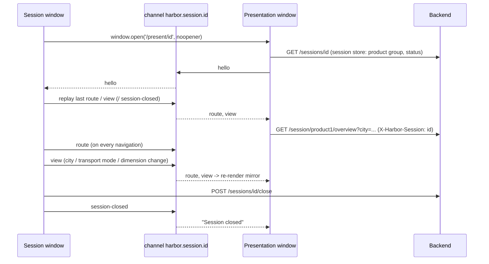

# Client presentation flow (two windows, one session)

## Purpose
A meeting has two audiences in one browser: the representative, who navigates and models, and the client, who must
see the results on a second screen without the internal controls. This flow describes how the two windows stay in
step without any backend involvement. Rules live in PRS-001; this document composes them with SES-001 (session
lifecycle) and the product and stress pages that publish their filters.

## Questions this document answers
- What happens, step by step, when the representative presses "Open client screen"?
- Which window publishes which message, and which component reacts?
- What does the client see while nothing has been published, and after the session is closed?
- Why does a client window opened late still show the right page?

## Trigger
The representative is inside an OPEN CLIENT session (`/session/:sessionId/*`) and presses "Open client screen" in
`SessionLayout`. Precondition: the session exists and is OPEN (SES-001).

## Participants
| Participant | Kind | Role in the flow |
|---|---|---|
| `feature:fe-app` (`SessionLayout`) | FE app shell | publishes `route`; opens the second window |
| `feature:product1`, `feature:product2`, `feature:stress` | FE features | publish `view` slices |
| `feature:meetings` (`useCloseSession`) | FE feature | publishes `session-closed` |
| `channel:harbor.session.{*}` | browser channel | one per session, same origin |
| `feature:presentation` (`PresentationPage`, mirrors) | FE feature | subscribes, sends `hello`, renders read-only counterparts |
| `endpoint:GET /api/v1/sessions/{sessionId}` and the session-scoped reads | BE | serve both windows identically |

## Steps

1. `SessionLayout` opens `/present/<id>` (`fe/src/components/layout/SessionLayout.tsx`). The new window mounts
   `PresentationLayout` (`src/components/layout/PresentationLayout.tsx:13`) and `PresentationPage` (`src/pages/PresentationPage/PresentationPage.tsx:21`).
2. `PresentationLayout` loads the session (`useSession`) and initialises the window's session store so that
   `sessionHeader()` works there.
3. `usePresentationSubscriber` (`src/components/hook/usePresentationSubscriber.ts:9`) opens the channel and sends `hello`.
4. Every `usePresentationPublisher` instance (`src/components/hook/usePresentationPublisher.ts:15`) answers `hello` by replaying its last message per type.
5. `PresentationPage` maps the `route` to a step (`stepFromPath`, `presentation.types.ts`) and renders the mirror with the
   published filters; the mirror fetches through the normal hooks.
6. Each navigation or filter change in the session window publishes again; the mirror re-renders.
7. `useCloseSession` publishes `session-closed` after the backend confirmed the close; the mirror shows "Session closed".

## Data and state changes
No persistent data. Window state: `PresentationState { route, view, closed }` in the presentation window; the
publishers keep the last message per type in memory for replay.

## Failure behaviour
- Backend error on a mirrored read: the mirror shows its loading / error text; the representative's window is unaffected.
- Presentation window closed by the client: nothing happens on the representative's side; a new window catches up via `hello`.
- Message with an unknown shape or unknown filter value: ignored or treated as "all" (BR-PRS-001-7).

## Invariants and assumptions
- Only `channel.ts` opens a `BroadcastChannel` (BR-PRS-001-2); the generated map `generated/fe/codebase-map.md` column
  Channels shows every publisher and subscriber.
- The two windows share origin and browser profile; a separate device needs a relayed variant (open question in PRS-001).
- The client window never shows controls or internal indicators (BR-PRS-001-1, BR-PRS-001-9).

## Security and privacy notes
Nothing internal crosses the boundary by design: the channel carries routes and filter values only; the client
window fetches its data itself through the same authorised session. Whether the client screen needs a weaker
authorisation than the representative's is an open question in PRS-001.

## Source map
| Concern | Location |
|---|---|
| Channel, message types, hooks | `fe/src/components/broadcast/sessionChannel.ts` |
| Step mapping, window state | `fe/src/types/presentation.ts` |
| Mirrors | `fe/src/pages/PresentationPage/PresentationPage.tsx`, `fe/src/pages/PresentationPage/components/{ProductMirror,ScenariosMirror,StressMirror}` |
| Publishers | `fe/src/components/layout/SessionLayout.tsx`, `fe/src/pages/Product1OverviewPage/Product1OverviewPage.tsx`, `fe/src/pages/Product2OverviewPage/Product2OverviewPage.tsx`, `fe/src/pages/StressTestPage/StressTestPage.tsx`, `fe/src/pages/SessionSummaryPage/hook/useCloseSession.ts` |
| Routes | `fe/src/routing/Routing.tsx:43-44` |

## Open questions
- [ ] Should the representative see a "client screen connected" indicator (requires a reply message from the subscriber)?
