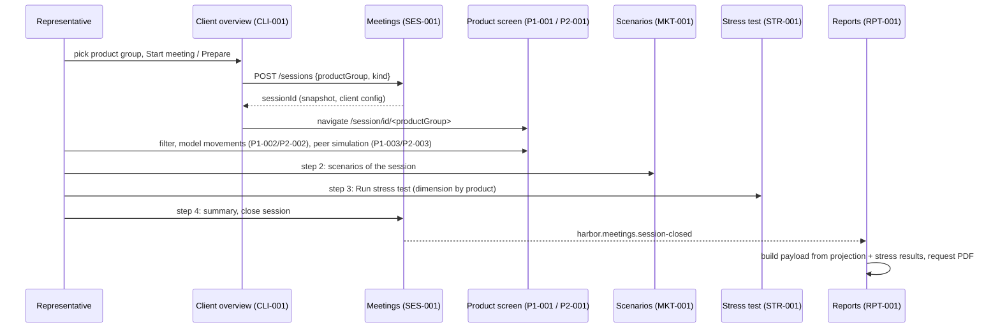

# Meeting journey (client → session → product screen → scenarios → stress test → report)

## Purpose
One meeting touches eight specs in a fixed order. Each spec owns its own rules; this document composes them so
that an analyst sees where a change lands in the journey and which screens come before and after it. It is the
same journey for both product groups: the product chosen on the client overview selects the product screen and
the breakdown dimension, nothing else branches.

## Questions this document answers
- Where is the product group of a meeting decided, and what does that decision drive later?
- In which order do the screens appear, and which spec owns each?
- What happens at the end of the meeting, and which contexts react to the close?

## Trigger
The representative is on the client overview (`/clients/:clientId`, CLI-001) and presses **Start meeting**
(session kind `CLIENT`) or **Prepare** (`PREPARATION`) for one product group. Precondition: the client exists; no
other `OPEN` session of that client for the same product group and kind (SES-001 BR-4).

## Participants
| Participant | Kind | Role in the flow |
|---|---|---|
| `feature:clients` (`ClientOverviewPage`) | FE feature | offers the two buttons per product group; creates the session; navigates |
| `endpoint:POST /api/v1/sessions` → `class:MeetingManager` | BE | creates the session with product group, parameter snapshot, client config (SES-001 BR-1 to BR-3) |
| `feature:fe-app` (`SessionLayout`) | FE app shell | binds the session, sends `X-Harbor-Session`, renders the step navigation |
| `feature:product1` / `feature:product2` | FE features | step 1: the product screen (P1-001 or P2-001) with its modals |
| `feature:market` | FE feature | step 2: scenarios (MKT-001) |
| `feature:stress` | FE feature | step 3: stress test (STR-001) |
| `feature:presentation` | FE feature | optional client window mirroring steps 1 to 3 (PRS-001, flow client-presentation) |
| `endpoint:POST /api/v1/sessions/{id}/close` → topic `harbor.meetings.session-closed` | BE | closes; reports and clients react (RPT-001, CLI-001 BR-6) |

## Steps

1. `ClientOverviewPage` calls `useCreateSession` with the chosen product group and kind and navigates to
   `/session/<id>/<productGroup>` (`fe/src/features/clients/ui/ClientOverviewPage.tsx:24-26`). The backend creates
   `meeting_session`, copies the parameter snapshot and inserts the client config (SES-001 BR-1 to BR-4).
2. `SessionLayout` loads the session, stores it so that every `/session/**` call carries `X-Harbor-Session`
   (SES-001 BR-5), and renders the steps Overview → Scenarios → Stress test → Summary
   (`fe/src/app/SessionLayout.tsx:37-41`).
3. Step 1 is the product screen chosen by `session.productGroup` (`fe/src/app/routes.tsx:34-35`): P1-001 with the
   city dimension or P2-001 with the transport mode. Its modals are P1-002 / P1-003 or P2-002 / P2-003; a saved
   movement set triggers the recalculation flow (`/flows/session-inputs-recalculation.md`).
4. Step 2 is the scenarios screen (MKT-001): the market scenarios the stress test will use.
5. Step 3 is the stress test (STR-001): **Run stress test** computes every scenario for the session's default
   dimension, city or transport mode by product (BR-STR-001-5), and stores the rows.
6. At any time from step 1 the representative may open the client window (PRS-001); the client-presentation flow
   describes how it follows the steps.
7. Step 4 closes the session (SES-001 BR-7): one `harbor.meetings.session-closed` event. Reports build the payload
   from the projection tables and the stored stress results and request the PDF
   (`be/core/src/main/kotlin/harbor/manager/ReportManager.kt:42-49`, RPT-001); clients apply a role override from a
   `CLIENT` session (CLI-001 BR-6 and BR-7).

## Data and state changes
`meeting_session`, `parameter_snapshot`, `session_client_config` at step 1; the session-scoped tables of each
screen afterwards (`session_movement_input`, `projection_*`, `session_peer_simulation`, `stress_test_result`);
`meeting_report` and `client_role` after the close. The frontend session store holds the bound session for the
header.

## Failure behaviour
- A second `OPEN` session for the same client, product group and kind → `409` at step 1 (SES-001 BR-4).
- A session-scoped call without the header → `428`; unknown or closed session → `404` / `409` (SES-001 BR-5, BR-6).
- A Product 1 operation on a Product 2 session or vice versa → `400` (BR-P2-001-5 and the Product 1 counterpart).
- Closing twice → `409`, no second event (SES-001 BR-8).

## Invariants and assumptions
- A session has exactly one product group, chosen at creation and never changed (SES-001 BR-1); every later
  screen derives its dimension from it (BR-P1-001-1, BR-P2-001-1, BR-STR-001-5).
- The parameter snapshot taken at creation is what every calculation of the meeting uses (SES-001 BR-2, BR-P1-001-4).
- The report is built only after the close and only from stored session data (RPT-001).

## Security and privacy notes
Nothing beyond the session header: all steps run under the representative's authorisation; the client window
rules are in PRS-001.

## Source map
| Concern | Location |
|---|---|
| Product choice and session creation | `fe/src/features/clients/ui/ClientOverviewPage.tsx`, `fe/src/features/meetings/api/useCreateSession.ts`, `be/core/src/main/kotlin/harbor/manager/MeetingManager.kt` |
| Step navigation, header binding | `fe/src/app/SessionLayout.tsx` |
| Routes per step | `fe/src/app/routes.tsx:31-38` |
| Close and downstream reactions | `be/core/src/main/kotlin/harbor/manager/MeetingManager.kt`, `be/core/src/main/kotlin/harbor/manager/ReportManager.kt`, `be/core/src/main/kotlin/harbor/event/ClientRoleSessionClosedListener.kt` |

## Open questions
- [ ] Should the step navigation prevent "Run stress test" before scenarios exist, or is an empty run acceptable
  (STR-001 BR-6)?

## Change log
| Date | Change | Ref |
|---|---|---|
| 2026-10-15 | Created with the spec split of product1 / product2 (conventions "Shaping specs") | — |
