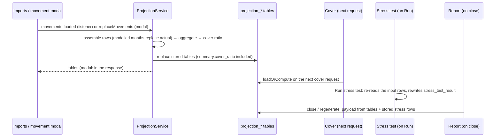

# Session inputs recalculation (imported or modelled movements → projection → cover → stress test → report)

## Purpose
An open meeting shows numbers that depend on two kinds of input: the actual movements imported by the imports
context and the modelled movements the representative enters in the movement modal. When either changes, some
figures follow immediately, some only on the next request, and some only when the user asks again. The specs own
the local rules (P1-001 BR-8, P1-002 BR-3, STR-001 BR-6); this document composes them so that nobody assumes a
cascade that does not exist.

## Questions this document answers
- Which screens show new numbers right after a movement save or an import, and which do not?
- Is the stress test rerun automatically? (No.)
- What does a report contain if inputs changed after the last stress run?

## Trigger
Either of:
- **Import**: a batch with accepted rows is published as `harbor.imports.movements-loaded` with the affected
  `clientIds` (`be/core/src/main/kotlin/harbor/event/MovementsLoadedPublisher.kt:22-35`).
- **Modal save**: `PUT /session/product1/movements` or `PUT /session/product2/movements` with a valid set
  (P1-002 BR-1 and BR-2, P2-002).

## Participants
| Participant | Kind | Role in the flow |
|---|---|---|
| `class:MovementsLoadedPublisher` (imports) | BE | publishes the topic after a batch |
| `class:Product1ProjectionRefreshListener`, `class:Product2ProjectionRefreshListener` | BE | one consumer group per product; recompute every OPEN session of the affected clients |
| `class:ProjectionService` | BE | recompute: assemble rows, aggregate, cover ratio, replace the stored tables |
| `class:CoverManager` | BE | reads the stored tables on the next request (cover summary, quotes) |
| `class:StressManager`, `class:StressTestService` | BE | recompute only on **Run stress test**; `get` returns the stored run |
| `class:ReportManager` | BE | builds the payload at close or regenerate from stored tables and stored stress rows |
| `hook:useProduct1Movements`, `hook:useProduct2Movements` | FE | after a save: cache the returned projection, invalidate the product and cover queries |

## Steps

1. The trigger reaches `ProjectionService`: the listener loops over the open scopes of each client and calls
   `recompute` (`Product1ProjectionRefreshListener.kt:24-29`, same for Product 2 with its own consumer group);
   the modal save calls `replaceMovements`, which deletes and inserts `session_movement_input` and then
   `recompute` (`ProjectionService.kt:78-96`).
2. `recompute` assembles the rows (months with modelled inputs use those inputs only, other months carry the
   actuals forward), aggregates the four tables, adds the cover ratio per month and replaces the stored tables
   (`ProjectionService.kt:56-71`). This is the only automatic recomputation.
3. The product screen shows the result: the modal response carries the tables (P1-002 BR-3), and the hook caches
   them and invalidates the product and cover queries (`useProduct1Movements.ts:17-21`). After an import, the
   screen sees the new tables on its next request (P1-001 BR-8).
4. Cover summary and quotes read the stored tables on their next request (`CoverManager.kt:38` and `:44`); the
   cover ratio chart series come with the overview (P1-001 BR-9).
5. The stress test is **not** rerun. `StressTestService.run` re-reads the input rows at run time
   (`StressTestService.kt:35-37`) and `StressManager.run` deletes and rewrites `stress_test_result`
   (`StressManager.kt:44-50`); until the representative presses **Run stress test** again, `getStressTest`
   returns the previous run (STR-001 BR-6 and the stored-run rule in the manager).
6. The peer simulation is unaffected: it reads the segment's `movement_monthly` rows, not the session tables
   (P1-003 BR-3).
7. The report payload is built at close or regenerate from the stored projection tables and the stored stress
   rows (`ReportManager.kt:42-49`): it carries the latest projection and the **last** stress run, whatever its age.

## Data and state changes
| When | Changed |
|---|---|
| step 1, modal save | `session_movement_input` of the session (replace all) |
| step 2 | `projection_by_subproduct`, `projection_by_dimension`, `projection_by_direction`, `projection_summary` of each recomputed session |
| step 5, only on Run | `stress_test_result` of the session |
| step 7, only on close / regenerate | `meeting_report.payload` |

## Failure behaviour
- Invalid modal rows → `400`, nothing changes, the modal stays open (P1-002 BR-2 and BR-5).
- An import batch arriving while a modal save is in its transaction → the listener's recompute runs after the
  commit (row lock on `projection_summary` by `session_id`, P1-002 edge cases).
- Kafka redelivery of the same batch → a second recompute with the same result (replace, not append).
- A listener failure for one client does not stop the loop for the others; the log line names the batch and
  the number of refreshed sessions.

## Invariants and assumptions
- After a successful save or batch, the stored projection tables of every open session of the client reflect the
  current inputs (P1-002 BR-3, P1-001 BR-8, P2-001 BR-6).
- Stress results are a snapshot of the inputs at their `generated_at`; nothing marks them stale (open question).
- Closed sessions are never recomputed (P1-001 BR-8).

## Security and privacy notes
None beyond the session scope: the listener recomputes inside `SessionContext.withScope` for each session, so
no client's rows leak into another session's tables.

## Source map
| Concern | Location |
|---|---|
| Publisher | `be/core/src/main/kotlin/harbor/event/MovementsLoadedPublisher.kt` |
| Listeners | `be/core/src/main/kotlin/harbor/event/Product1ProjectionRefreshListener.kt`, `Product2ProjectionRefreshListener.kt` |
| Recompute, replace | `be/core/src/main/kotlin/harbor/service/ProjectionService.kt`, `ProjectionInputAssembler.kt` |
| Cover reads | `be/core/src/main/kotlin/harbor/manager/CoverManager.kt` |
| Stress run and stored run | `be/core/src/main/kotlin/harbor/manager/StressManager.kt`, `be/core/src/main/kotlin/harbor/service/StressTestService.kt` |
| Report payload | `be/core/src/main/kotlin/harbor/manager/ReportManager.kt`, `ReportPayloadService.kt` |
| FE cache invalidation | `fe/src/pages/Product1OverviewPage/hook/useProduct1Movements.ts`, `fe/src/pages/Product2OverviewPage/hook/useProduct2Movements.ts` |

## Open questions
- [ ] Should a stress run be flagged stale, or rerun automatically, when the projection of its session changes
  after `generated_at` (owner: harbor-platform-team)? Today the report may combine a fresh projection with an old
  stress run.
- [ ] Should the client window be told that numbers changed after an import (PRS-001 publishes filters only)?

## Change log
| Date | Change | Ref |
|---|---|---|
| 2026-10-15 | Created with the spec split of product1 / product2 (conventions "Shaping specs") | — |
